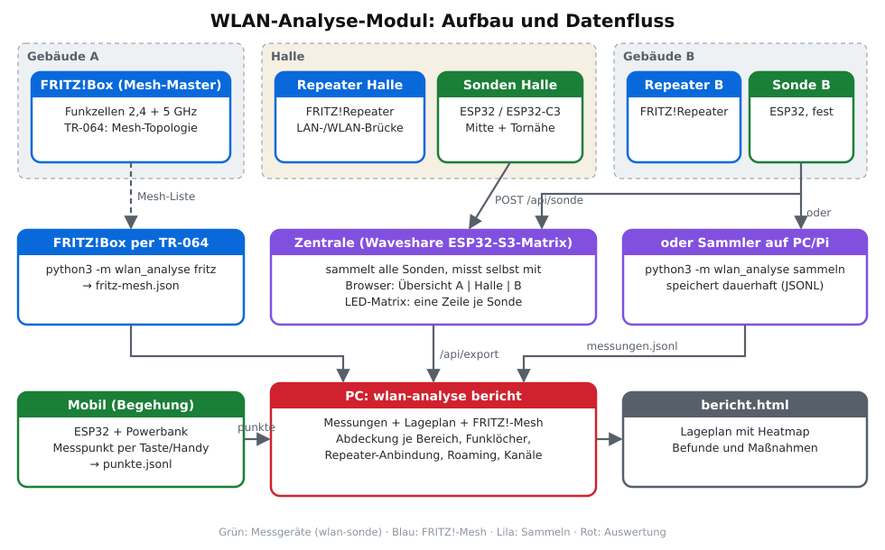
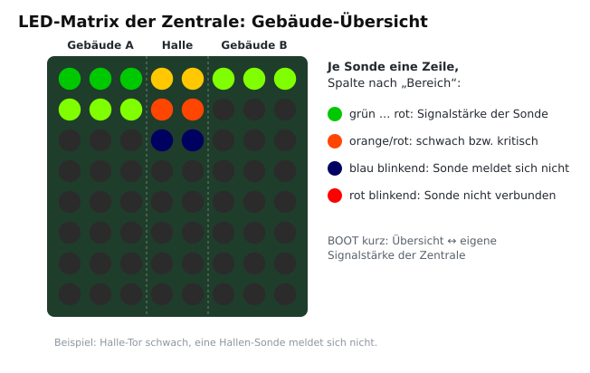
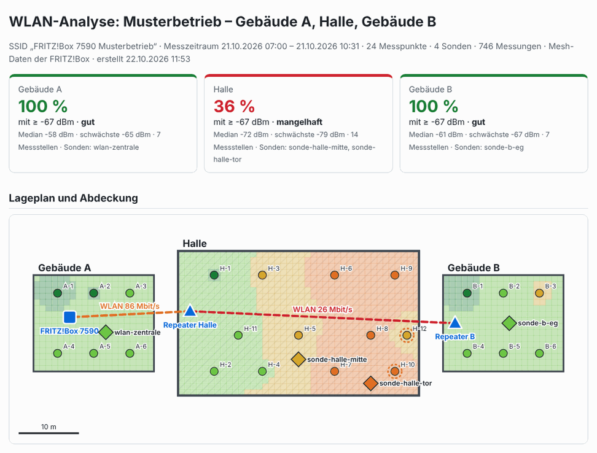

# 6 – WLAN-Analyse: zwei Gebäude mit Halle

Ein Analyse-Modul, das die WLAN-Abdeckung eines **FRITZ!-Mesh-Netzes** über mehrere
Gebäude misst, auswertet und konkrete Maßnahmen vorschlägt. Zugeschnitten auf die
typische Lage **Gebäude A – Halle – Gebäude B**. Die Werkzeuge funktionieren aber für
jeden Lageplan.

<p align="center"></p>

| Baustein | Was | Wo |
|---|---|---|
| **Sonde** | ESP32 fest montiert, misst alle 30 s, meldet an die Zentrale | [`projects/wlan-sonde`](../projects/wlan-sonde) |
| **Mobil** | ESP32 + Powerbank für die Begehung, Messpunkt per Taste oder Handy | gleiche Firmware, Rolle „mobil“ |
| **Zentrale** | Waveshare ESP32-S3-Matrix: sammelt alle Sonden, Übersicht im Browser und auf der LED-Matrix | gleiche Firmware, Rolle „zentrale“ |
| **FRITZ!Box-Mesh** | Topologie: Repeater, BSSIDs, Anbindung LAN/WLAN mit Datenrate | `python3 -m wlan_analyse fritz` |
| **Auswertung** | Bericht mit Lageplan, Heatmap, Befunden und Maßnahmen | [`tools/wlan-analyse`](../tools/wlan-analyse) |
| **Schnellcheck** | einzelnes Gerät mit Live-Anzeige, ohne Auswertung | [`projects/wlan-matrix`](../projects/wlan-matrix) |

---

## 1. Grundlagen: FRITZ!-Mesh in mehreren Gebäuden

| Begriff | Bedeutung |
|---|---|
| **Mesh-Master** | Die FRITZ!Box. Sie verwaltet das Mesh und verteilt WLAN-Einstellungen an alle Repeater. |
| **Mesh-Repeater** | FRITZ!Repeater oder zweite FRITZ!Box. Sendet dieselbe SSID mit eigener **BSSID** (MAC-Adresse der Funkzelle). |
| **Anbindung (Backhaul)** | Verbindung Repeater → Master. **WLAN-Brücke** (Funk) oder **LAN-Brücke** (Kabel). Über sie läuft der gesamte Verkehr des Repeaters. |
| **Kaskade** | Repeater hängt per Funk an einem Repeater, der selbst per Funk angebunden ist. Jede Funkstrecke kostet etwa die Hälfte des Durchsatzes. |
| **Mesh Steering** | Die FRITZ!Box lenkt Geräte, die 802.11k/v beherrschen, zum besseren Knoten und Band. Einfache Geräte (Scanner, Sensoren, ESP32) wechseln erst, wenn die Verbindung abreißt. |
| **2,4 / 5 GHz** | 2,4 GHz reicht weiter und durchdringt Wände besser. 5 GHz ist schneller, reicht aber deutlich weniger weit. Der ESP32 misst nur 2,4 GHz. |

### Warum die Halle in der Mitte das Problem ist

```
 ┌── Gebäude A ──┐   ┌──────────── Halle ────────────┐   ┌── Gebäude B ──┐
 │  FRITZ!Box ▣  │   │  Regale · Stapler · Rolltore │   │  Repeater ▲   │
 │               │   │                              │   │               │
 └───────────────┘   └──────────────────────────────┘   └───────────────┘
       Außenwand + Hallenwand          30–60 m           Hallenwand + Außenwand
```

- **Wände:** Jede Außenwand kostet etwa 6–15 dB. Stahlbeton, Sandwichpaneele mit Blechhaut und beschichtetes
  Glas dämpfen am stärksten. Funk aus Gebäude A in die Halle muss mindestens zwei Wände durchdringen.
- **Entfernung:** Hallen sind groß. Ab etwa 30 m reicht auch ohne Hindernisse ein Repeater am Rand nicht mehr bis zur gegenüberliegenden Seite.
- **Einrichtung:** Hochregale, Maschinen und Ware (besonders Wasser, Metall, Papier in großen Mengen) schatten ab.
  Die Abdeckung schwankt mit Belegung, Staplerverkehr und offenen oder geschlossenen Toren.
- **Anbindung von Gebäude B:** Ein Repeater in B, der per Funk quer durch die Halle an der FRITZ!Box
  hängt, hat oft gutes Signal zum Endgerät, aber eine sehr langsame Funkstrecke zum Master.
  Dann zeigt das Handy volle Balken, und trotzdem ist alles langsam.

**Typische Lösung:** Ein eigener Mesh-Knoten in der Hallenmitte und ein Kabel zwischen den Gebäuden.
Das Kabel geht an den Hallen-Repeater und an den Repeater in B (jeweils LAN-Brücke). Das Analyse-Modul
zeigt, ob und wo das nötig ist, und weist die Verbesserung nach der Umsetzung nach.

---

## 2. Messplan

| Schritt | Dauer | Ergebnis |
|---|---|---|
| ① FRITZ!-Mesh einlesen | 2 min | Welche Repeater, welche BSSIDs, LAN oder WLAN, Datenrate der Anbindung |
| ② Begehung mit Gerät „mobil“ | 30–60 min | Messpunkte im Raster, „bester Knoten“ je Punkt, Funklöcher |
| ③ Dauermessung mit Sonden | 1–7 Tage | Schwankungen im Betrieb, Abbrüche, AP-Wechsel, Antwortzeit, Paketverlust |
| ④ Bericht erstellen | 1 min | Lageplan, Abdeckung je Bereich, Befunde, Maßnahmen |
| ⑤ Maßnahmen umsetzen, ②–④ wiederholen | – | Vorher/Nachher-Vergleich |

### Wo die Sonden hinkommen

| Sonde | Ort | Warum |
|---|---|---|
| **Zentrale** (Waveshare-Matrix) | Gebäude A, Büro (gut sichtbar) | Referenz nahe der FRITZ!Box, Anzeige für alle |
| Sonde A | Gebäude A, weitester Raum oder anderes Stockwerk | Reichweite im Hauptgebäude |
| Sonde Halle Mitte | Halle Mitte, 2–3 m hoch an einer Säule | schwierigster Punkt, Arbeitsbereich |
| Sonde Halle Tor | Halle, Nähe Rolltor bzw. Seite zu Gebäude B | Schwankung durch Tore und Verkehr, Übergang zu B |
| Sonde B | Gebäude B, Arbeitsplatz | Abdeckung und Antwortzeit hinter der Repeater-Kette |

- **Höhe:** Sonden ungefähr dort anbringen, wo die Endgeräte genutzt werden: 1–1,5 m für Arbeitsplätze, Scanner und Tablets.
  Für die Bewertung eines Repeater-Standorts auf Montagehöhe messen.
- **Stromversorgung:** USB-Netzteil. Für die Begehung reicht eine Powerbank.
- **Begehung:** Messpunkte etwa alle 5–10 m, in der Halle in jeder Gasse. Punkte benennen,
  z. B. `A-EG-1`, `H-3`, `B-OG-2`, und im Lageplan (`standort.json`) mit Koordinaten eintragen.
  Je Punkt sammelt das Gerät 10 Werte in 3 s und macht einen Scan sowie 5 Anfragen an den Router.
  Das dauert etwa 6–8 s, in dieser Zeit stehen bleiben.

### Hardware

| Rolle | Empfohlenes Board | Env |
|---|---|---|
| Zentrale mit Anzeige | [Waveshare ESP32-S3-Matrix](boards/waveshare-esp32-s3-matrix.md) | `waveshare_s3_matrix` (Rolle ist voreingestellt) |
| feste Sonde | [ESP32-DevKitC](boards/esp32-devkitc.md) oder ESP32-C3 Super Mini | `esp32dev`, `esp32c3` |
| Mobil | beliebiges ESP32-Board, gern mit Matrix für den Fortschritt | `esp32dev`, `esp32dev_matrix`, `waveshare_s3_matrix` |

Alle Geräte möglichst **gleich bauen** (gleiches Board, gleiche Antenne, gleiche Ausrichtung).
Nur dann sind die Werte untereinander vergleichbar.

---

## 3. Ablauf Schritt für Schritt

### ① FRITZ!-Mesh einlesen

In der FRITZ!Box einmalig unter **Heimnetz → Netzwerk → Netzwerkeinstellungen** die Option
**„Zugriff für Anwendungen zulassen“** aktivieren. Der verwendete FRITZ!Box-Benutzer braucht das
Recht **„FRITZ!Box Einstellungen“**.

```bash
cd tools/wlan-analyse
mkdir -p daten                                                          # eigene Daten, nicht im Git
python3 -m wlan_analyse fritz --benutzer admin -o daten/fritz-mesh.json   # fragt nach dem Passwort
```

Ausgabe (Beispiel):

```
FRITZ!Box 7590 [FRITZ!Box 7590]  (Mesh-Master)
    2,4 GHz Kanal   6  3C:A6:2F:11:22:33
  Repeater Halle [FRITZ!Repeater 1200 AX]  <- WLAN 5 GHz von FRITZ!Box 7590, 86 Mbit/s
      2,4 GHz Kanal   6  E0:28:6D:44:55:66
    Repeater B [FRITZ!Repeater 3000 AX]  <- WLAN 5 GHz von Repeater Halle, 26 Mbit/s
        2,4 GHz Kanal   6  DC:15:C8:77:88:99
```

Schon hier sieht man: Repeater B hängt als Kaskade mit nur 26 Mbit/s an der Halle.

### ② Geräte flashen und einrichten

```bash
cd projects/wlan-sonde
pio run -e waveshare_s3_matrix -t upload     # Zentrale
pio run -e esp32dev -t upload                # je Sonde / Mobilgerät
```

Beim ersten Start öffnet jedes Gerät den Hotspot `WLAN-Sonde-XXXX` (Passwort `12345678`).
Im Portal stehen neben dem WLAN auch die Einstellungen:

| Feld | Zentrale | Sonde | Mobil |
|---|---|---|---|
| Gerätename | `wlan-zentrale` | z. B. `sonde-halle-mitte` | `sonde-mobil` |
| Rolle | `zentrale` | `sonde` | `mobil` |
| Bereich | `A` | `A`, `Halle` oder `B` | Standard für Messpunkte |
| Ort | „Büro EG“ | „Halle Mitte, Säule 4, 3 m“ | – |
| Zentrale | – | `http://wlan-zentrale.local` | – |
| Intervall | 30 s | 30 s | – |

Alles lässt sich später in der Weboberfläche unter **Einstellungen** ändern (`http://<name>.local/`).

Die Zentrale zeigt auf der LED-Matrix je Sonde eine Zeile, aufgeteilt in **A | Halle | B**:

<p align="center"></p>

### ③ Begehung

Mobilgerät einschalten, mit dem Handy `http://sonde-mobil.local/` öffnen. Punkt-ID eingeben,
Bereich wählen, **Messen**. Die Punkt-ID zählt danach automatisch hoch (`H-3` → `H-4`).
Ohne Handy geht es mit der **BOOT-Taste**: kurz drücken, dann wird ein Punkt `P1`, `P2`, … aufgenommen.

Die Tabelle zeigt sofort den **besten Knoten** je Punkt. Steht dort *„nicht verbunden!“*,
hängt das Gerät an einem schwächeren Knoten. Das ist ein Hinweis auf Roaming-Probleme.

### ④ Daten holen und Bericht erstellen

```bash
cd tools/wlan-analyse
python3 -m wlan_analyse abrufen wlan-zentrale.local sonde-mobil.local -o daten/messungen.jsonl
cp beispiel/standort.json daten/standort.json      # dann Maße, Geräte, Sonden, Punkte anpassen
python3 -m wlan_analyse bericht -s daten/standort.json -m daten/messungen.jsonl \
        --mesh daten/fritz-mesh.json -o daten/bericht.html --oeffnen
```

<p align="center"></p>

Den vollständigen Beispielbericht erzeugt `python3 -m wlan_analyse demo --oeffnen`.

Für eine **Dauermessung über Tage** ohne ESP32-Zentrale kann ein PC oder Raspberry Pi sammeln.
In den Sonden wird dann als Zentrale `http://<IP des PCs>:8080` eingetragen:

```bash
python3 -m wlan_analyse sammeln --port 8080 -o daten/messungen.jsonl
```

---

## 4. Bewertung

| Wert | Bedeutung |
|---|---|
| **≥ −55 dBm** | sehr gut |
| **≥ −65 dBm** | gut |
| **≥ −67 dBm** | **Zielwert** für Sprache/Video und sauberes Roaming |
| **≥ −72 dBm** | brauchbar für Daten, Scanner, Surfen |
| **≥ −80 dBm** | schwach: langsame Datenrate, gelegentliche Abbrüche |
| **< −80 dBm** | kritisch: Funkloch |

- **Abdeckung je Bereich** = Anteil der Messstellen, an denen der *beste* Knoten ≥ −67 dBm erreicht.
  Die Bewertung ist *gut* ab 90 % (und keine Stelle unter −80 dBm), *ausreichend* ab 70 %, darunter *mangelhaft*.
- **10 %-Wert** einer Sonde: In 10 % der Zeit ist das Signal so schlecht oder schlechter. Er zeigt Schwankungen durch Betrieb.
- **„Falscher Knoten“**: Der verbundene Knoten ist mindestens 8 dB schwächer als der beste erreichbare.
- **Antwortzeit**: Aufbau einer TCP-Verbindung zum Router, entspricht etwa einem Ping. Jede Funkstrecke
  im Mesh addiert einige Millisekunden. Paketverlust > 2 % deutet auf eine schwache Strecke hin.
- **Repeater-Anbindung**: unter 150 Mbit/s Warnung, unter 60 Mbit/s kritisch.

---

## 5. Maßnahmenkatalog für Gebäude A – Halle – Gebäude B

| Befund | Maßnahme |
|---|---|
| Halle mangelhaft, Gebäude gut | Mesh-Knoten **in** die Halle, zentral und erhöht (3–4 m), freie Sicht in die Gassen. Ein Repeater an der Hallenwand reicht selten bis zur anderen Seite. |
| Repeater per WLAN mit < 150 Mbit/s | Näher an den Elternknoten setzen oder **per LAN anbinden** (FRITZ!Repeater: LAN-Brücke). |
| Kaskade A → Halle → B per Funk | Mindestens die erste Strecke per Kabel. Besser: Kabel A → Halle → B und alle Repeater als LAN-Brücke. |
| Kein Kabel zwischen den Gebäuden möglich | Leerrohr/Erdkabel prüfen (CAT 7 Außenkabel bis 90 m, darüber Glasfaser). Alternativ eine Richtfunkstrecke (Outdoor-Bridge, 5 GHz oder 60 GHz) mit Sichtverbindung. Powerline nur, wenn beide Gebäude am selben Stromkreis/Zähler hängen – vorher testen. |
| „Falscher Knoten“ in Übergangszonen | Mesh Steering wirkt nur bei Geräten mit 802.11k/v. Knoten so platzieren, dass sich die Zellen weniger stark überlappen. Für einfache Geräte (Scanner) ggf. einen Knoten näher an den Einsatzort. |
| Starke Schwankungen (10 %-Wert ≪ Median) | Knoten höher montieren, nicht hinter Regalen oder Metall. Bei Rolltoren die Seite wählen, die nicht abgeschattet wird. |
| Überlappende Fremdnetze (Kanal 2–5, 7–10) | Im 2,4-GHz-Band nur Kanäle 1, 6, 11. In der FRITZ!Box unter WLAN → Funkkanal automatisch wählen lassen oder den freiesten der drei fest einstellen. |
| Abbrüche nur an einer Sonde | Ereignisprotokoll der Sonde ansehen: *Beacon-Timeout* = Signal verloren, *Handshake/Auth* = Störung oder falsches Passwort. |

Nach jeder Änderung die Begehung an denselben Punkten wiederholen und einen neuen Bericht erstellen.
Die Punkt-IDs im Lageplan bleiben gleich, dadurch sind die Berichte direkt vergleichbar.

---

## 6. Lageplan (`standort.json`)

Koordinaten in Metern, x nach rechts, y nach unten. Ein vollständiges Beispiel liegt unter
[`tools/wlan-analyse/beispiel/standort.json`](../tools/wlan-analyse/beispiel/standort.json).

```json
{
  "name": "Musterbetrieb",
  "ssid": "FRITZ!Box 7590 Musterbetrieb",
  "bereiche": [
    {"id": "A", "name": "Gebäude A", "x": 0, "y": 0, "breite": 20, "hoehe": 16, "art": "gebaeude"},
    {"id": "halle", "name": "Halle", "x": 24, "y": -4, "breite": 40, "hoehe": 24, "art": "halle"},
    {"id": "B", "name": "Gebäude B", "x": 68, "y": 0, "breite": 20, "hoehe": 16, "art": "gebaeude"}
  ],
  "geraete": [ {"name": "FRITZ!Box 7590", "bereich": "A", "x": 6, "y": 7} ],
  "sonden":  [ {"name": "sonde-halle-mitte", "bereich": "halle", "x": 44, "y": 14, "ort": "Halle Mitte"} ],
  "punkte":  [ {"id": "H-1", "bereich": "halle", "x": 30, "y": 0} ]
}
```

- `geraete[].name` muss zum Gerätenamen in der FRITZ!Box passen (gleich oder enthalten).
  Ohne FRITZ!Box-Daten kann man BSSIDs unter `"bssids": ["E0:28:6D:44:55:66"]` eintragen. Ohne beides
  ordnet die Auswertung jede BSSID dem nächstgelegenen Gerät am Ort des stärksten Empfangs zu
  (im Bericht als *geschätzt* markiert).
- `sonden[].name` = Gerätename der Sonde, `punkte[].id` = Punkt-ID der Begehung.

---

## 7. Datenformat

Alle Geräte exportieren **JSON Lines** (eine Messung je Zeile, `GET /api/export`). Sonden senden
dieselbe Zeile per `POST /api/sonde` an die Zentrale bzw. den Sammler.

| Feld | Typ | Bedeutung |
|---|---|---|
| `typ` | `"messung"` \| `"punkt"` | Dauermessung einer Sonde bzw. Messpunkt der Begehung |
| `sonde`, `bereich`, `ort` | Text | Gerätename, Bereich, Beschreibung |
| `punkt` | Text | Punkt-ID (nur `typ = punkt`) |
| `t` | Zahl | Unix-Zeit (0 = Uhrzeit unbekannt) |
| `uptime`, `intervall` | Zahl | Sekunden seit Start, Messintervall |
| `verbunden` | bool | Verbindung zum Messzeitpunkt |
| `bssid`, `kanal` | Text, Zahl | verbundener Mesh-Knoten (nur wenn verbunden) |
| `rssi`, `rssi_min`, `rssi_max` | dBm | Mittel, Minimum, Maximum im Messzeitraum |
| `abbrueche`, `wechsel` | Zahl | Zähler seit Start der Sonde |
| `antwort_ms` | Zahl \| null | Antwortzeit des Routers (Mittel aus 5 Anfragen, null = keine Antwort) |
| `verlust` | % | Anteil verlorener Anfragen |
| `knoten` | Liste | alle Knoten mit gleicher SSID: `{bssid, rssi, kanal}` |
| `fremd` | Liste | fremde Netze je Kanal: `{kanal, anzahl, max}` |

Beispiel:

```json
{"typ":"messung","sonde":"sonde-halle-mitte","bereich":"Halle","ort":"Halle Mitte","t":1792911600,"uptime":3620,"intervall":30,"verbunden":true,"bssid":"E0:28:6D:44:55:66","kanal":6,"rssi":-71,"rssi_min":-75,"rssi_max":-68,"abbrueche":0,"wechsel":0,"antwort_ms":8.4,"verlust":0,"knoten":[{"bssid":"E0:28:6D:44:55:66","rssi":-70,"kanal":6},{"bssid":"DC:15:C8:77:88:99","rssi":-84,"kanal":6}],"fremd":[{"kanal":1,"anzahl":2,"max":-80}]}
```

## 8. Grenzen der Messung

- Nur **2,4 GHz**: 5-GHz-Abdeckung ist kleiner. Mit dem Smartphone (FRITZ!App WLAN) an den gleichen Punkten gegenprüfen.
- ESP32-Antennen empfangen schwächer als Smartphones und Laptops. Die Werte dienen dem **Vergleich innerhalb** des Standorts.
- Gemessen wird die **Empfangsrichtung**. Wie stark die Sonde beim Access Point ankommt, liefert, falls verfügbar, die FRITZ!Box
  (im Bericht „am AP“).
- Ein Scan dauert 2–4 s. In dieser Zeit wechselt der ESP32 kurz die Kanäle, und Antworten können sich um einige hundert Millisekunden verzögern.
