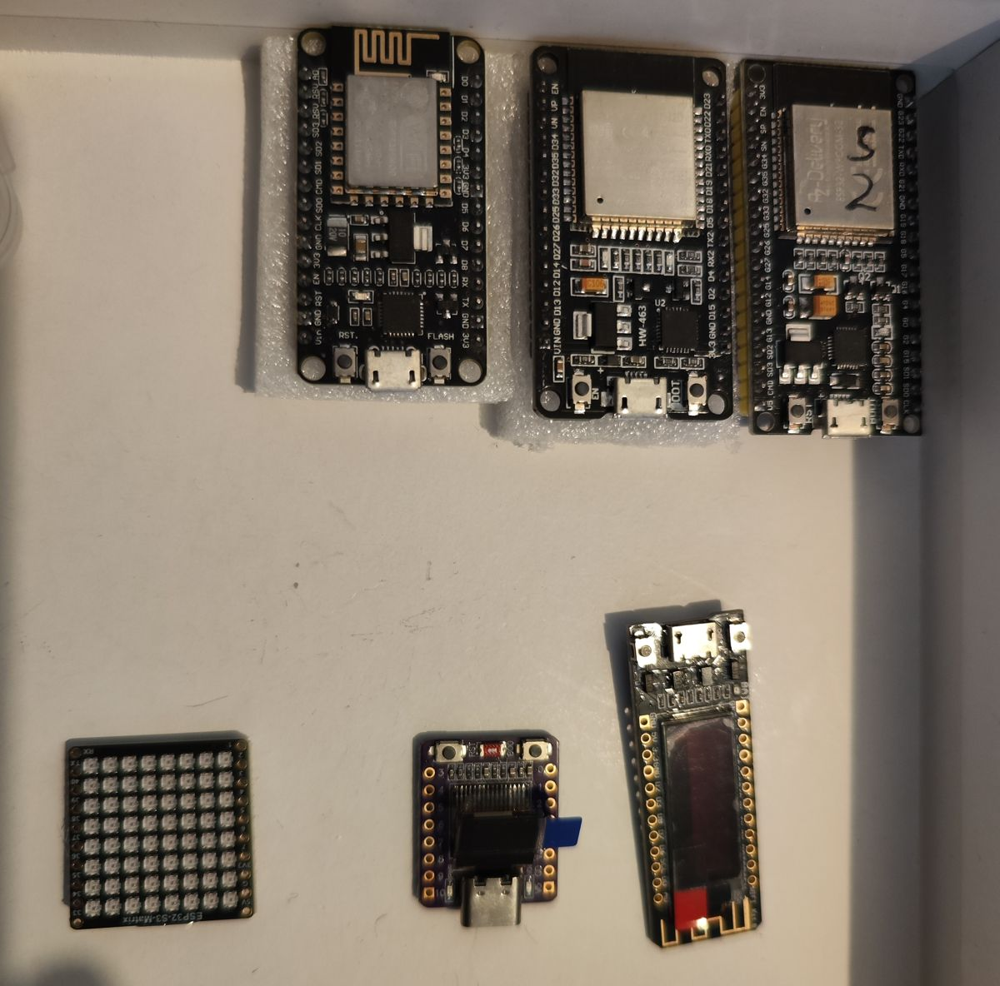
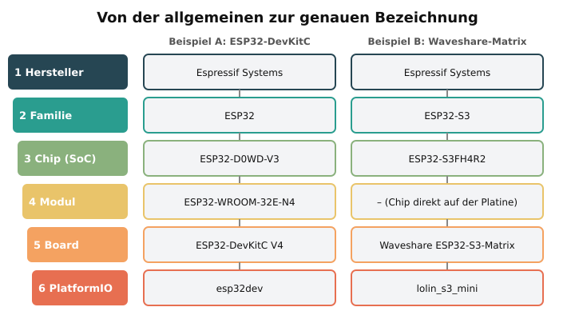

# Board-Dokumentation

Für jedes Board, das in diesem Repo verwendet wird, gibt es eine eigene Seite. Sie
beschreibt es Schritt für Schritt **von der allgemeinen zur genauen Bezeichnung**,
mit Abbildung, Pinbelegung und den passenden Einstellungen.

| Board                                                        | Familie  | Chip / Modul                     | PlatformIO-Basis           | Env im Repo            |
|--------------------------------------------------------------|----------|----------------------------------|----------------------------|------------------------|
| [ESP32-DevKitC V4](esp32-devkitc.md)                         | ESP32    | ESP32-D0WD-V3 / ESP32-WROOM-32E  | `esp32_base`               | `esp32dev`             |
| [ESP32-S3-DevKitC-1](esp32-s3-devkitc-1.md)                  | ESP32-S3 | ESP32-S3 / ESP32-S3-WROOM-1      | `esp32s3_base`             | `esp32s3`              |
| [Waveshare ESP32-S3-Matrix](waveshare-esp32-s3-matrix.md)    | ESP32-S3 | ESP32-S3FH4R2 (ohne Modul)       | `waveshare_s3_matrix_base` | `waveshare_s3_matrix`  |
| [DOIT ESP32 DevKit V1 (30 Pins)](doit-esp32-devkit-v1.md)    | ESP32    | ESP32-D0WD / ESP32-WROOM-32      | `doit_devkit_v1_base`      | `doit_devkit_v1`       |
| [NodeMCU V2](nodemcu-v2.md)                                  | ESP8266  | ESP8266EX / ESP-12E/F            | `esp8266_base`             | `nodemcuv2`            |
| [Heltec WiFi Kit 8](heltec-wifi-kit-8.md)                    | ESP8266  | ESP8266EX (ohne Modul) + OLED    | `heltec_wifi_kit_8_base`   | `heltec_wifi_kit_8`    |
| [ESP32-C3 mit 0,42″-OLED](esp32-c3-oled-042.md)              | ESP32-C3 | ESP32-C3FN4/FH4 (ohne Modul) + OLED | `esp32c3_oled_base`     | `esp32c3_oled`         |

## Eigene Boards zuordnen

<p align="center"></p>

| Position im Foto | Erkennungsmerkmal                                       | Board-Seite |
|------------------|---------------------------------------------------------|-------------|
| oben links       | ESP-12-Blechmodul mit Mäander-Antenne, Pins D0–D8, Tasten RST/FLASH | [NodeMCU V2](nodemcu-v2.md) (**ESP8266**) |
| oben Mitte       | 2×15 Pins, Aufdruck **HW-463**, Pins D23, D22 …, EN/BOOT | [DOIT ESP32 DevKit V1](doit-esp32-devkit-v1.md) |
| oben rechts      | 2×19 Pins, Pins G23, G22, CMD …, AZ-Delivery-Modul, mit „2“ markiert | [ESP32-DevKitC V4](esp32-devkitc.md) |
| unten links      | 8×8-LED-Feld, Aufdruck „ESP32-S3-Matrix“                 | [Waveshare ESP32-S3-Matrix](waveshare-esp32-s3-matrix.md) |
| unten Mitte      | lila, USB-C, winziges OLED, Tasten BOOT/RST              | [ESP32-C3 mit 0,42″-OLED](esp32-c3-oled-042.md) |
| unten rechts     | lang und schmal, OLED über fast die ganze Länge, Micro-USB | [Heltec WiFi Kit 8](heltec-wifi-kit-8.md) (**ESP8266**) |

Funktionstest: [`blink`](../../projects/blink) für alle Boards, [`oled-demo`](../../projects/oled-demo)
für die OLED-Boards, [`matrix-demo`](../../projects/matrix-demo) für die Matrix.

Neues Board aufnehmen: [`_vorlage.md`](_vorlage.md) kopieren und den Schritten in
[„Neues Board dokumentieren“](#neues-board-dokumentieren) folgen.

---

## Von der Familie zum Board: wie ESP-Bezeichnungen aufgebaut sind

Ein „ESP32“ im Online-Shop kann sehr verschiedene Hardware sein. Die Bezeichnung
wird von oben nach unten immer genauer:

<p align="center"></p>

| Ebene             | Was ist das?                                                      | Beispiel                                   | Wo steht es?                                |
|-------------------|-------------------------------------------------------------------|--------------------------------------------|---------------------------------------------|
| 1. Hersteller     | Entwickelt den Chip                                               | Espressif Systems                          | –                                           |
| 2. Familie / Serie| Generation mit gemeinsamer CPU-Architektur und Funktionen         | ESP8266, ESP32, ESP32-S3, ESP32-C3         | Datenblatt                                  |
| 3. Chip (SoC)     | Das eigentliche Silizium, ggf. mit Flash/PSRAM im Gehäuse         | ESP32-D0WD-V3, ESP32-S3FH4R2               | Aufdruck auf dem Chip, `esptool chip_id`    |
| 4. Modul          | Chip + Flash + PSRAM + Quarz + Antenne unter einem Blechdeckel    | ESP32-WROOM-32E-N4, ESP32-S3-WROOM-1-N16R8 | Aufdruck auf dem Blechdeckel                |
| 5. Board          | Platine mit Modul, USB, Spannungsregler, Tastern, Stiftleisten    | ESP32-DevKitC V4, Waveshare ESP32-S3-Matrix| Aufdruck auf der Platine / Händlerangabe    |
| 6. PlatformIO     | Board-Profil, mit dem gebaut wird                                 | `esp32dev`, `esp32-s3-devkitc-1`           | `boards/boards.ini`                          |

### Chip-Bezeichnungen lesen

| Bezeichnung       | Bedeutung                                                                 |
|-------------------|---------------------------------------------------------------------------|
| `ESP32-D0WD-V3`   | **D** = Dual-Core, **0** = kein Flash im Chip, **WD** = WLAN + Bluetooth (Dual Mode), **V3** = Chip-Revision 3 |
| `ESP32-S3FH4R2`   | **S3** = Serie, **F** = Flash im Chip, **H** = hochtemperaturfest, **4** = 4 MB Flash, **R2** = 2 MB PSRAM |
| `ESP32-C3FH4`     | **C3** = RISC-V-Serie, Flash im Chip, 4 MB                                 |

### Modul-Bezeichnungen lesen

`ESP32-S3-WROOM-1U-N16R8`

| Teil      | Bedeutung                                                         |
|-----------|-------------------------------------------------------------------|
| `ESP32-S3`| Chip-Serie im Modul                                               |
| `WROOM`   | Modul ohne zusätzliches PSRAM (bei ESP32) bzw. Standardmodul; `WROVER` = mit PSRAM |
| `-1`      | Bauform (Größe, Pinanordnung)                                     |
| `U`       | **U.FL**-Buchse für externe Antenne statt PCB-Antenne             |
| `N16`     | **16 MB** Flash (N4, N8, N16 …)                                   |
| `R8`      | **8 MB** PSRAM; bei S3: `R2` = Quad-SPI, `R8` = Octal-SPI         |

> **Praxis:** Bei ESP32-S3-Modulen mit **R8** (Octal-PSRAM) sind GPIO 35–37 belegt,
> und in PlatformIO muss `board_build.arduino.memory_type = qio_opi` gesetzt sein.

### Welches Board habe ich?

1. Aufdruck auf dem Blechdeckel lesen (Modul + Flash/PSRAM).
2. Aufdruck auf der Platinen-Rückseite lesen (Board-Name, Version).
3. Per USB auslesen:

   ```bash
   pip install esptool
   esptool.py flash_id      # Chip-Typ, Revision, Flash-Größe, MAC
   ```

   Beispielausgabe: `Chip is ESP32-S3 (QFN56) (revision v0.2)`,
   `Embedded PSRAM 2MB`, `Detected flash size: 4MB`.

---

## Neues Board dokumentieren

1. `docs/boards/_vorlage.md` nach `docs/boards/<board-name>.md` kopieren und ausfüllen.
2. Optional ein eigenes Foto des Boards (zugeschnitten, ca. 600 px, JPEG) nach
   `docs/boards/fotos/<board-name>.jpg` legen und unter dem Bild einbinden.
   Nur eigene Fotos, keine Herstellerbilder.
3. Pinbelegung als JSON in `docs/boards/specs/<board-name>.json` anlegen
   (Format: Kopf von `scripts/board-image.py`) und Bild erzeugen:

   ```bash
   python3 scripts/board-image.py docs/boards/specs/<board-name>.json
   ```

4. Board in die Tabelle oben eintragen.
5. Basis-Sektion in `boards/boards.ini` ergänzen und in den Projekten ein `[env:…]` anlegen.
6. Prüfen: `python3 scripts/check-docs.py`

Diese Schritte erledigt auch der Claude-Skill **esp-doku** (`.claude/skills/esp-doku/`).
