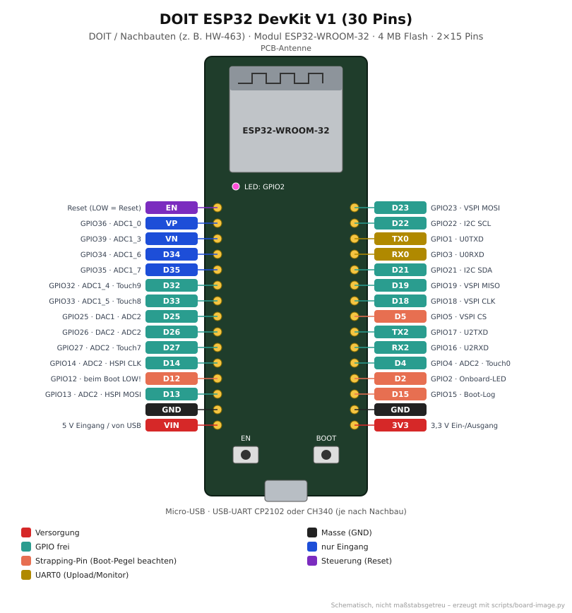
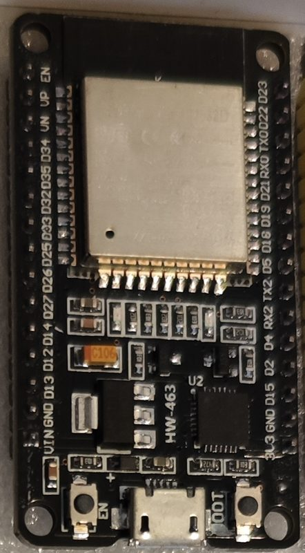

# DOIT ESP32 DevKit V1 (30 Pins)

<p align="center"></p>

<p align="center"><br><em>Eigenes Exemplar: Nachbau mit Aufdruck HW-463, 2×15 Pins, Beschriftung D23, D22 …</em></p>

Der verbreitete 30-Pin-Allrounder mit ESP32-WROOM-32. Verkauft als „ESP32 DevKit V1“,
„ESP32 DOIT“, „ESP-WROOM-32 30 Pin“ oder mit Platinenaufdruck wie **HW-463**. Er ist
schmaler als das [ESP32-DevKitC](esp32-devkitc.md) mit 38 Pins und hat weniger Pins, weil
die Flash-Pins (GPIO6–11) und GPIO0 nicht herausgeführt sind.

## Von der Familie zum Board

| Ebene       | Bezeichnung                              | Erklärung |
|-------------|------------------------------------------|-----------|
| Hersteller  | Espressif Systems (Chip), DOIT bzw. Nachbauer (Board) | |
| Familie     | **ESP32**                                | Xtensa LX6, 2 Kerne, WLAN + Bluetooth Classic + BLE |
| Chip        | **ESP32-D0WDQ6** bzw. **ESP32-D0WD-V3**  | je nach Modul-Charge (Aufdruck oder `esptool.py chip_id`) |
| Modul       | **ESP32-WROOM-32** (4 MB Flash)          | bei neueren Nachbauten auch WROOM-32D/E |
| Board       | **DOIT ESP32 DevKit V1**, 2×15 Pins      | Modul + USB-UART (CP2102 oder CH340) + 3,3-V-Regler (AMS1117) + EN/BOOT + blaue LED an GPIO2 |
| PlatformIO  | `esp32doit-devkit-v1` → Basis `doit_devkit_v1_base` | siehe [`boards/boards.ini`](../../boards/boards.ini) |

## Technische Daten

| Eigenschaft | Wert |
|-------------|------|
| CPU         | 2× Xtensa LX6, bis 240 MHz |
| Speicher    | 520 KB SRAM, 4 MB Flash |
| Funk        | WLAN 802.11 b/g/n 2,4 GHz, Bluetooth 4.2 + BLE |
| GPIOs       | 25 herausgeführt, davon 4 nur Eingang (34, 35, 36, 39) |
| USB         | Micro-USB, CP2102 oder CH340 (Treiber!) |
| Versorgung  | 5 V über USB oder VIN, 3,3 V am 3V3-Pin |
| Logikpegel  | 3,3 V (**nicht 5-V-tolerant**) |
| Abmessungen | ca. 51 × 28 mm, Reihenabstand 25,4 mm (passt nicht auf ein einzelnes Steckbrett) |

## Pinbelegung

**Frei nutzbar (empfohlen):** 4, 13, 14, 16, 17, 18, 19, 21, 22, 23, 25, 26, 27, 32, 33

| GPIO           | Einschränkung |
|----------------|---------------|
| 1, 3 (TX0/RX0) | UART0 – Upload und serieller Monitor |
| 2 (D2)         | Strapping-Pin, Onboard-LED (blau, active HIGH) – beim Flashen LOW/offen |
| 5, 15          | Strapping-Pins – beim Start nicht fest auf einen Pegel ziehen |
| 12 (D12)       | Strapping-Pin – beim Start HIGH → bootet nicht |
| 34, 35, 36, 39 | nur Eingang, keine internen Pull-ups |
| ADC2 (2, 4, 12–15, 25–27) | analog nicht nutzbar, solange WLAN läuft – für Analogmessung GPIO 32–39 (ADC1) |

**Standard-Schnittstellen (Arduino):** I2C SDA 21 / SCL 22 · SPI (VSPI) MOSI 23, MISO 19,
SCK 18, CS 5 · UART2 RX 16 / TX 17.

Die Beschriftung `D2`, `D4` … auf der Platine meint **GPIO-Nummern** (anders als beim
ESP8266-NodeMCU!). Im Code also einfach `2`, `4` … schreiben.

## Verwendung im Repo

```bash
cd projects/blink
pio run -e doit_devkit_v1 -t upload -t monitor
```

| Zweck     | Einstellung |
|-----------|-------------|
| Projekte  | `[env:doit_devkit_v1]` mit `extends = doit_devkit_v1_base` (in `blink`, `oled-demo`, `_template`); `esp32dev` funktioniert ebenso |
| OLED-Test | [`projects/oled-demo`](../../projects/oled-demo) mit externem SSD1306 128×64 an 21/22 |
| WLAN-Analyse | [`wlan-sonde`](../../projects/wlan-sonde) Env `doit_devkit_v1` (feste Sonde) bzw. `doit_devkit_v1_oled` (mit 0,96″-OLED) |
| WLED      | Env `wled_esp32` in [`wled/platformio_override.ini`](../../wled/platformio_override.ini), LED-Daten an GPIO16 (RX2) |

## Typische Probleme

| Problem | Ursache / Lösung |
|---------|------------------|
| `Failed to connect … Timed out waiting for packet header` | BOOT gedrückt halten, bis „Connecting…“ weiterläuft (Auto-Reset fehlt bei vielen Nachbauten) |
| Kein COM-Port | CH340- oder CP210x-Treiber installieren; reines Ladekabel ohne Datenleitungen? |
| Hoher Strom im Deep Sleep (mA statt µA) | AMS1117, USB-UART und Power-LED ziehen weiter Strom – für Batteriebetrieb ungeeignet |
| Bootet nicht mit angeschlossenem Sensor | Sensor zieht GPIO12 auf HIGH → anderen Pin nehmen |

## Quellen

- Espressif: [ESP32 Datenblatt](https://www.espressif.com/sites/default/files/documentation/esp32_datasheet_en.pdf)
- Espressif: [ESP32-WROOM-32 Datenblatt](https://www.espressif.com/sites/default/files/documentation/esp32-wroom-32_datasheet_en.pdf)
- CircuitState: [DOIT ESP32 DevKit V1 Pinout-Referenz](https://circuitstate.com/esp32dkpinref)
- PlatformIO: [DOIT ESP32 DEVKIT V1](https://docs.platformio.org/en/latest/boards/espressif32/esp32doit-devkit-v1.html)
