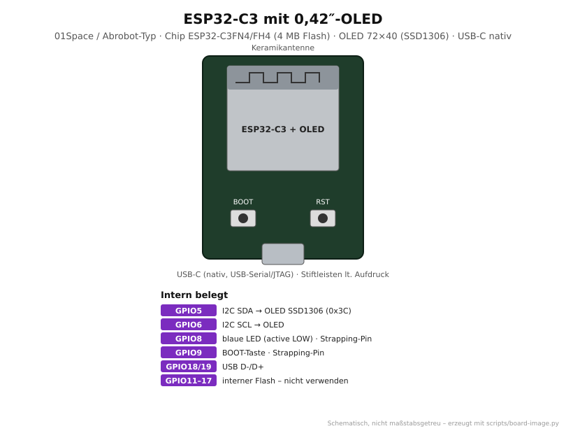
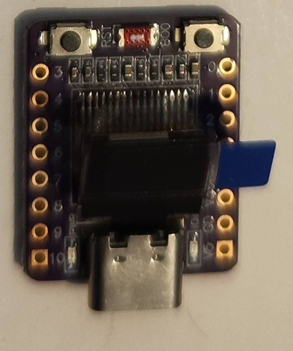

# ESP32-C3 mit 0,42″-OLED

<p align="center"></p>

<p align="center"><br><em>Eigenes Exemplar: lila Platine, USB-C, BOOT/RST oben, OLED in der Mitte</em></p>

Sehr kleines ESP32-C3-Board (meist lila Platine) mit winzigem **0,42″-OLED (72×40)**,
USB-C und Keramikantenne. Verkauft als „ESP32-C3 0.42 OLED“, „01Space ESP32-C3-0.42LCD“
oder von Abrobot. Gut für kompakte Statusanzeigen mit WLAN und BLE.

> Die Reihenfolge der Stiftleisten ist je nach Nachbau unterschiedlich und deshalb
> nicht eingezeichnet. Bitte am Aufdruck ablesen.

## Von der Familie zum Board

| Ebene       | Bezeichnung                    | Erklärung |
|-------------|--------------------------------|-----------|
| Hersteller  | Espressif (Chip), 01Space bzw. Abrobot (Board) | |
| Familie     | **ESP32-C3**                   | RISC-V, 1 Kern, WLAN + BLE 5, natives USB (Serial/JTAG) |
| Chip        | **ESP32-C3FN4** bzw. **ESP32-C3FH4** | **F** = Flash im Chip, **N/H** = Temperaturbereich, **4** = 4 MB |
| Modul       | – (keins)                      | Chip direkt auf der Platine |
| Board       | **ESP32-C3 0,42″ OLED**        | + OLED 72×40 (SSD1306-kompatibel), BOOT/RST, blaue LED, USB-C |
| PlatformIO  | `esp32-c3-devkitm-1` → Basis `esp32c3_oled_base` | gleicher Chip und Flash wie das DevKitM-1; siehe [`boards/boards.ini`](../../boards/boards.ini) |

## Technische Daten

| Eigenschaft | Wert |
|-------------|------|
| CPU         | 1× RISC-V, 160 MHz |
| Speicher    | 400 KB SRAM, 4 MB Flash (im Chip) |
| Funk        | WLAN 802.11 b/g/n 2,4 GHz, Bluetooth 5 (LE) |
| Display     | 0,42″ OLED, sichtbar 72×40, SSD1306-kompatibel, I2C 0x3C |
| GPIOs       | ca. 12 herausgeführt |
| USB         | USB-C, nativ (kein USB-UART-Chip) |
| Versorgung  | 5 V über USB oder 5V-Pin, 3,3 V am 3V3-Pin |
| Logikpegel  | 3,3 V |

## Pinbelegung

| GPIO       | Funktion / Einschränkung |
|------------|--------------------------|
| 5          | OLED SDA (**nicht** 8/9 wie in manchen Schaltplänen) |
| 6          | OLED SCL |
| 8          | blaue LED, **active LOW**; Strapping-Pin (beim Download-Start HIGH) |
| 9          | BOOT-Taste, Strapping-Pin (LOW beim Start = Download-Modus) |
| 2          | Strapping-Pin – beim Start nicht auf LOW ziehen |
| 18, 19     | USB D-/D+ – nicht verwenden, sonst kein Upload/Monitor |
| 11–17      | interner Flash – nicht verwenden |
| 20, 21     | UART0 RX/TX (frei, da die Konsole über USB läuft) |

**Frei nutzbar (empfohlen):** 0, 1, 3, 4, 7, 10, 20, 21. ADC: GPIO0–4 (ADC1).

## Verwendung im Repo

```bash
cd projects/oled-demo
pio run -e esp32c3_oled -t upload -t monitor
```

| Zweck     | Einstellung |
|-----------|-------------|
| Projekte  | `[env:esp32c3_oled]` mit `extends = esp32c3_oled_base` (in `blink`, `oled-demo`, `_template`) |
| WLAN-Analyse | [`wlan-sonde`](../../projects/wlan-sonde) Env `esp32c3_oled`: handliches Begehungsgerät (Rolle „mobil“), Anzeige von Signal, Fortschritt und Punkten |
| Defines   | `OLED_SDA_PIN=5`, `OLED_SCL_PIN=6`, `OLED_WIDTH=72`, `OLED_HEIGHT=40`, `LED_BUILTIN_PIN=8`, `LED_ACTIVE_LOW=1` |
| USB       | `ARDUINO_USB_MODE=1`, `ARDUINO_USB_CDC_ON_BOOT=1` (aus `esp32c3_base`) – sonst keine serielle Ausgabe |
| Display   | U8g2: `U8G2_SSD1306_72X40_ER_F_HW_I2C(U8G2_R0, U8X8_PIN_NONE, 6, 5)` – Reset, SCL, SDA |
| Arduino IDE | „ESP32C3 Dev Module“, USB CDC On Boot: Enabled, Flash Mode DIO |

## Typische Probleme

| Problem | Ursache / Lösung |
|---------|------------------|
| Keine Ausgabe im seriellen Monitor | USB CDC On Boot fehlt – mit den Envs im Repo gesetzt |
| Upload findet keinen Port / hängt | BOOT halten, RST kurz drücken, BOOT loslassen → Download-Modus, dann hochladen |
| Text abgeschnitten oder verschoben | Mit 128×64-Treiber erscheint das Bild versetzt. 72×40-Treiber nehmen; falls dennoch verschoben: 128×64-Treiber mit Offset x≈28, y≈24 |
| WLAN schwach | Bekannte Schwäche mancher Nachbauten (Antennenabstimmung). `WiFi.setTxPower(WIFI_POWER_8_5dBm)` hilft paradoxerweise oft |

## Quellen

- Espressif: [ESP32-C3 Datenblatt](https://www.espressif.com/sites/default/files/documentation/esp32-c3_datasheet_en.pdf)
- 01Space: [ESP32-C3-0.42LCD (Schaltplan, Beispiele)](https://github.com/01Space/ESP32-C3-0.42LCD)
- U8g2: [SSD1306 72x40 Setup](https://github.com/olikraus/u8g2/wiki/u8g2setupcpp#ssd1306-72x40_er)
