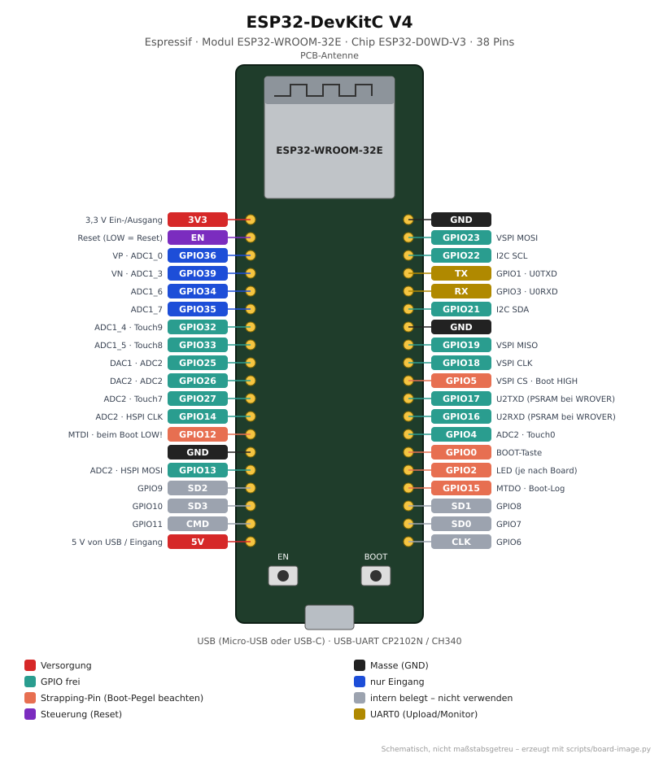
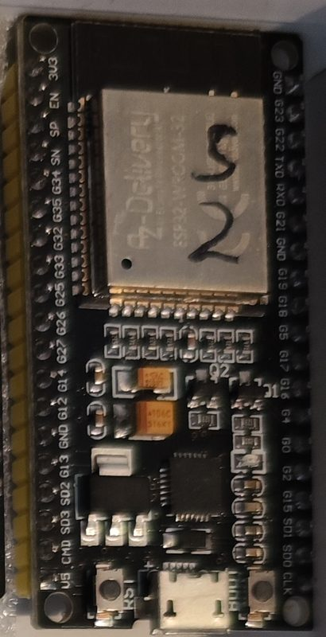

# ESP32-DevKitC V4

<p align="center"></p>

<p align="center"><br><em>Eigenes Exemplar: AZ-Delivery-Board im DevKitC-Layout, 38 Pins, Beschriftung G23, G22, CMD … (mit „2“ markiert)</em></p>

Das „Standard-ESP32-Board“. Viele günstige Boards mit 38 Pins (oft als „ESP32 DevKit“,
„ESP32-WROOM-32 Development Board“ oder „NodeMCU-32S“ verkauft) sind Nachbauten davon.

## Von der Familie zum Board

| Ebene       | Bezeichnung                         | Erklärung                                                        |
|-------------|-------------------------------------|------------------------------------------------------------------|
| Hersteller  | Espressif Systems                   |                                                                  |
| Familie     | **ESP32**                           | Die erste ESP32-Generation: Xtensa LX6, 2 Kerne, WLAN + Bluetooth Classic + BLE |
| Chip        | **ESP32-D0WD-V3**                   | Dual-Core, kein Flash im Chip, WLAN + BT Dual Mode, Revision 3   |
| Modul       | **ESP32-WROOM-32E-N4**              | Chip + 4 MB Flash + 40-MHz-Quarz + PCB-Antenne unter Blechdeckel (ältere Boards: WROOM-32, WROOM-32D) |
| Board       | **ESP32-DevKitC V4**                | Modul + USB-UART-Wandler + 3,3-V-Regler + EN/BOOT-Taster + 2×19 Pins |
| PlatformIO  | `esp32dev` → Basis `esp32_base`     | siehe [`boards/boards.ini`](../../boards/boards.ini)             |

**Eigenes Exemplar (Inventar #1, mit „2“ markiert):** AZ-Delivery-Board im DevKitC-Layout,
38 Pins, Pins beschriftet `G23`, `G22`, `TXD`, `RXD`, `CMD` …, Micro-USB, Modul
ESP32-WROOM-32 mit AZ-Delivery-Aufdruck. Belegung wie im Bild oben, Env `esp32dev`.

**Varianten:** `ESP32-WROOM-32UE` (U.FL-Antennenbuchse), `ESP32-WROVER-E` (zusätzlich
8 MB PSRAM; dann sind GPIO16/17 belegt), N8/N16 = 8/16 MB Flash.

## Technische Daten

| Eigenschaft        | Wert                                                     |
|--------------------|----------------------------------------------------------|
| CPU                | 2× Xtensa LX6, bis 240 MHz                               |
| RAM                | 520 KB SRAM                                              |
| Flash              | 4 MB (Modulvariante N4)                                  |
| Funk               | WLAN 802.11 b/g/n 2,4 GHz, Bluetooth 4.2 + BLE           |
| GPIOs              | 34, davon 4 nur Eingang (34–39) und 6 für den Flash belegt (6–11) |
| ADC / DAC          | 18 Kanäle 12 Bit (ADC2 nicht nutzbar bei aktivem WLAN) / 2× 8 Bit (GPIO25, 26) |
| Touch              | 10 kapazitive Eingänge                                   |
| Versorgung         | 5 V über USB oder 5V-Pin, oder 3,3 V am 3V3-Pin          |
| Logikpegel         | 3,3 V (**nicht 5-V-tolerant**)                            |
| USB                | Micro-USB oder USB-C, Wandler CP2102N (original) bzw. CH340/CH9102 (Nachbauten) |
| Abmessungen        | ca. 55 × 28 mm, Rastermaß 2,54 mm, Reihenabstand 22,86 mm (passt **nicht** auf ein einzelnes Steckbrett) |

## Pinbelegung

**Frei nutzbar (empfohlen):** 4, 13, 14, 16, 17, 18, 19, 21, 22, 23, 25, 26, 27, 32, 33

| GPIO           | Einschränkung                                                         |
|----------------|-----------------------------------------------------------------------|
| 0              | BOOT-Taste – beim Start LOW = Download-Modus                          |
| 1, 3           | UART0 TX/RX – für Upload und seriellen Monitor                        |
| 2              | Strapping-Pin, muss beim Flashen LOW/offen sein; Onboard-LED bei vielen Nachbauten |
| 5, 15          | Strapping-Pins (Boot-Meldungen, SDIO-Timing) – beim Start nicht fest auf Pegel ziehen |
| 6–11           | interner SPI-Flash – **niemals verwenden**                             |
| 12             | Strapping-Pin (Flash-Spannung) – beim Start HIGH → bootet nicht        |
| 34, 35, 36, 39 | nur Eingang, keine internen Pull-ups                                  |
| ADC2 (0, 2, 4, 12–15, 25–27) | analog nicht nutzbar, solange WLAN läuft                 |

**Standard-Schnittstellen (Arduino):** I2C SDA 21 / SCL 22 · SPI (VSPI) MOSI 23, MISO 19,
SCK 18, CS 5 · UART2 RX 16 / TX 17.

Das DevKitC V4 selbst hat **keine** frei programmierbare LED, nur eine Power-LED.
Viele Nachbauten haben eine blaue LED an GPIO2 – daher `LED_BUILTIN_PIN=2` in `boards.ini`.

## Verwendung im Repo

```bash
cd projects/blink
pio run -e esp32dev -t upload -t monitor
```

| Zweck            | Einstellung                                                        |
|------------------|--------------------------------------------------------------------|
| Projekte         | `[env:esp32dev]` mit `extends = esp32_base`                        |
| Partitionen      | `min_spiffs.csv` (1,9 MB App ×2 für OTA, 190 KB Dateisystem)       |
| WLED             | Env `wled_esp32` in [`wled/platformio_override.ini`](../../wled/platformio_override.ini), LED-Daten an GPIO16 |
| WLED-Release     | `WLED_x.y.z_ESP32.bin`                                             |

## Typische Probleme

| Problem                                         | Ursache / Lösung                                                       |
|-------------------------------------------------|------------------------------------------------------------------------|
| Upload hängt bei `Connecting....___`            | BOOT gedrückt halten, bis „Writing“ erscheint (manche Nachbauten haben keine Auto-Reset-Schaltung) |
| Bootet nicht, wenn Sensor angeschlossen         | Sensor zieht GPIO12 auf HIGH → anderen Pin nehmen                      |
| `Brownout detector was triggered`               | USB-Kabel/Port liefert zu wenig Strom (WLAN-Spitzen bis 500 mA)        |

## Quellen

- Espressif: [ESP32-DevKitC V4 – Benutzerhandbuch](https://docs.espressif.com/projects/esp-dev-kits/en/latest/esp32/esp32-devkitc/user_guide.html)
- Espressif: [ESP32 Datenblatt](https://www.espressif.com/sites/default/files/documentation/esp32_datasheet_en.pdf)
- Espressif: [ESP32-WROOM-32E Datenblatt](https://www.espressif.com/sites/default/files/documentation/esp32-wroom-32e_esp32-wroom-32ue_datasheet_en.pdf)
