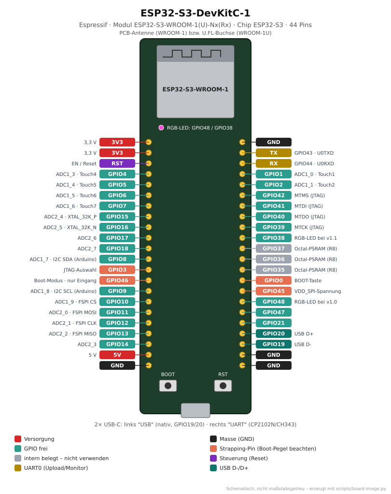

# ESP32-S3-DevKitC-1

<p align="center"></p>

Offizielles Entwicklungsboard für den ESP32-S3 mit zwei USB-C-Buchsen und RGB-LED.
Viele „ESP32-S3 N16R8“-Boards aus dem Handel sind Nachbauten mit derselben Pinbelegung.

## Von der Familie zum Board

| Ebene       | Bezeichnung                              | Erklärung                                                           |
|-------------|------------------------------------------|---------------------------------------------------------------------|
| Hersteller  | Espressif Systems                        |                                                                     |
| Familie     | **ESP32-S3**                             | Xtensa LX7, 2 Kerne, Vektor-Befehle für KI/DSP, natives USB, BLE 5 (kein Bluetooth Classic) |
| Chip        | **ESP32-S3** (QFN56)                     | Variante ohne internen Flash; Flash/PSRAM sitzen im Modul           |
| Modul       | **ESP32-S3-WROOM-1-N8R8** (häufig) bzw. `-N16R8`, `-N8`, `-1U-…` | N = Flash in MB, R = PSRAM in MB, U = U.FL-Antennenbuchse |
| Board       | **ESP32-S3-DevKitC-1 v1.0 / v1.1**       | Modul + USB-UART-Wandler + natives USB + RGB-LED + 2×22 Pins       |
| PlatformIO  | `esp32-s3-devkitc-1` → Basis `esp32s3_base` | siehe [`boards/boards.ini`](../../boards/boards.ini)             |

**Version erkennen:** Aufdruck auf der Rückseite. v1.0 hat die RGB-LED an **GPIO48**, v1.1 an **GPIO38**.

## Technische Daten

| Eigenschaft        | Wert                                                     |
|--------------------|----------------------------------------------------------|
| CPU                | 2× Xtensa LX7, bis 240 MHz                               |
| RAM                | 512 KB SRAM + PSRAM je nach Modul (2 MB Quad oder 8 MB Octal) |
| Flash              | 4–16 MB je nach Modul                                    |
| Funk               | WLAN 802.11 b/g/n 2,4 GHz, Bluetooth 5 (LE)              |
| GPIOs              | 45 (0–21, 26–48), auf dem Board 36 herausgeführt          |
| ADC                | 20 Kanäle 12 Bit (ADC2 nicht nutzbar bei aktivem WLAN)   |
| Touch              | 14 kapazitive Eingänge (GPIO1–14)                        |
| USB                | **„USB“**: natives USB-OTG / USB-Serial-JTAG (GPIO19/20) · **„UART“**: CP2102N bzw. CH343 an UART0 |
| Onboard-LED        | adressierbare RGB-LED (WS2812-kompatibel)                |
| Logikpegel         | 3,3 V (**nicht 5-V-tolerant**)                            |
| Abmessungen        | ca. 63 × 26 mm                                           |

## Pinbelegung

**Frei nutzbar (empfohlen):** 1, 2, 4–18, 21, 38–42, 47, 48 (bei R8 nicht 35–37)

| GPIO       | Einschränkung                                                              |
|------------|----------------------------------------------------------------------------|
| 0          | BOOT-Taste – Strapping-Pin                                                 |
| 3          | Strapping-Pin (JTAG-Quelle) – beim Start nicht fest auf Pegel ziehen       |
| 19, 20     | USB D-/D+ – nur nutzen, wenn natives USB nicht gebraucht wird              |
| 26–32      | intern für Flash/PSRAM – nicht herausgeführt                               |
| 33–37      | bei **Octal-PSRAM (R8)** belegt – **nicht verwenden**                      |
| 39–42      | JTAG – frei nutzbar, wenn kein JTAG-Debugger verwendet wird                |
| 43, 44     | UART0 TX/RX – Upload und Monitor über die „UART“-Buchse                    |
| 45, 46     | Strapping-Pins (Flash-Spannung, Boot-Modus); 46 nur Eingang                |

**Standard-Schnittstellen (Arduino):** I2C SDA 8 / SCL 9 · SPI (FSPI) MOSI 11, MISO 13,
SCK 12, CS 10. Fast alle Funktionen lassen sich über die GPIO-Matrix auf beliebige Pins legen.

## Welche USB-Buchse?

| Buchse      | Port unter Linux | Wann nutzen?                                                        |
|-------------|------------------|---------------------------------------------------------------------|
| **UART**    | `/dev/ttyUSB0`   | Immer funktionierender Upload + Monitor, auch nach Absturz          |
| **USB**     | `/dev/ttyACM0`   | Natives USB: Monitor mit `ARDUINO_USB_CDC_ON_BOOT=1`, JTAG-Debugging, USB-Geräte (Tastatur, MIDI …) |

In `boards.ini` ist `ARDUINO_USB_CDC_ON_BOOT=1` gesetzt: `Serial` gibt dann über die
**USB**-Buchse aus. Wer nur die UART-Buchse nutzt, entfernt das Flag.

## Speicher-Einstellungen nach Modul

| Modul                    | PlatformIO-Zusatz in `[env:…]`                                         |
|--------------------------|------------------------------------------------------------------------|
| N8 (ohne PSRAM)          | – (Standard von `esp32-s3-devkitc-1`)                                  |
| N8R2 (Quad-PSRAM)        | `build_flags = ${esp32s3_base.build_flags} -D BOARD_HAS_PSRAM`         |
| N8R8 / N16R8 (Octal-PSRAM)| `board_build.arduino.memory_type = qio_opi`, `board_upload.flash_size = 16MB` (bei N16), `-D BOARD_HAS_PSRAM` |

## Verwendung im Repo

```bash
cd projects/blink
pio run -e esp32s3 -t upload -t monitor
```

| Zweck            | Einstellung                                                        |
|------------------|--------------------------------------------------------------------|
| Projekte         | `[env:esp32s3]` mit `extends = esp32s3_base`                       |
| Onboard-LED      | RGB-LED → mit `neopixelWrite(48, r, g, b)` bzw. Adafruit NeoPixel ansteuern; `digitalWrite` schaltet sie nicht |
| WLED-Release     | `WLED_x.y.z_ESP32-S3_8MB_opi.bin` (N8R8) bzw. `…_16MB_opi.bin` (N16R8) |

## Typische Probleme

| Problem                                       | Ursache / Lösung                                                         |
|-----------------------------------------------|--------------------------------------------------------------------------|
| Keine Ausgabe im Monitor                      | Falsche Buchse für `ARDUINO_USB_CDC_ON_BOOT` – siehe Tabelle oben       |
| Port verschwindet nach dem Upload (USB-Buchse)| Normal beim nativen USB: neu verbinden, ggf. BOOT halten + RST drücken |
| Absturz beim Zugriff auf PSRAM                | `memory_type` passt nicht zum Modul (Octal vs. Quad)                     |
| GPIO35–37 reagieren nicht                     | Modul hat Octal-PSRAM (R8) – Pins sind belegt                            |

## Quellen

- Espressif: [ESP32-S3-DevKitC-1 – Benutzerhandbuch](https://docs.espressif.com/projects/esp-dev-kits/en/latest/esp32s3/esp32-s3-devkitc-1/user_guide.html)
- Espressif: [ESP32-S3 Datenblatt](https://www.espressif.com/sites/default/files/documentation/esp32-s3_datasheet_en.pdf)
- Espressif: [ESP32-S3-WROOM-1 Datenblatt](https://www.espressif.com/sites/default/files/documentation/esp32-s3-wroom-1_wroom-1u_datasheet_en.pdf)
