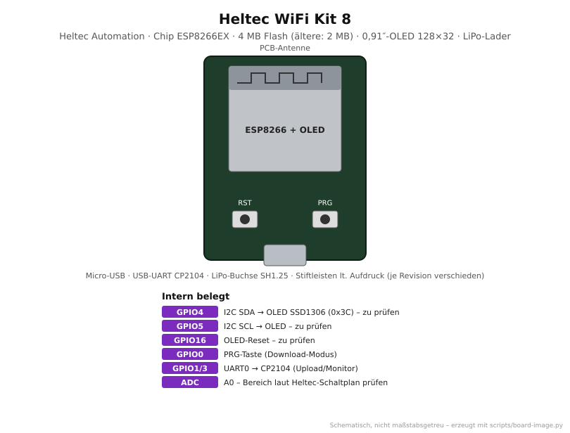
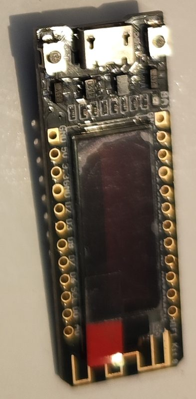

# Heltec WiFi Kit 8

<p align="center"></p>

<p align="center"><br><em>Eigenes Exemplar: langes, schmales Board mit OLED über fast die ganze Länge, Micro-USB</em></p>

Kleines ESP8266-Board von Heltec mit fest verbautem **0,91″-OLED (128×32)** und
**LiPo-Laderegler**. Es eignet sich für kompakte Statusanzeigen im Akkubetrieb.
**Kein ESP32:** ESP8266-Core, kein Bluetooth.

> Heltec hat mehrere Revisionen gebaut (2017, 2019, „V A“), die sich bei Flash-Größe,
> Stiftleisten-Reihenfolge und **OLED-Pins** unterscheiden. Alle mit „zu prüfen“
> markierten Angaben vor dem Verdrahten am Platinenaufdruck bzw. Heltec-Pinout prüfen.
> Die Stiftleisten sind deshalb im Bild nicht eingezeichnet.

## Von der Familie zum Board

| Ebene       | Bezeichnung              | Erklärung |
|-------------|--------------------------|-----------|
| Hersteller  | Espressif (Chip), Heltec Automation (Board) | |
| Familie     | **ESP8266**              | Tensilica L106, 1 Kern, nur WLAN |
| Chip        | **ESP8266EX**            | direkt auf der Platine, kein Blechmodul |
| Modul       | – (keins)                | Chip, Flash und Antenne direkt auf dem Board |
| Board       | **Heltec WiFi Kit 8** (HTIT-W8266) | + 4 MB Flash (frühe Revisionen 2 MB), CP2104, OLED 128×32 (SSD1306), LiPo-Lader |
| PlatformIO  | `heltec_wifi_kit_8` → Basis `heltec_wifi_kit_8_base` | siehe [`boards/boards.ini`](../../boards/boards.ini) |

## Technische Daten

| Eigenschaft | Wert |
|-------------|------|
| CPU         | 1× Tensilica L106, 80/160 MHz |
| Speicher    | ca. 80 KB RAM, 4 MB Flash (ältere Revision: 2 MB – mit `esptool.py flash_id` prüfen) |
| Funk        | WLAN 802.11 b/g/n 2,4 GHz |
| Display     | 0,91″ OLED, 128×32, SSD1306, I2C-Adresse 0x3C |
| USB         | Micro-USB, CP2104 |
| Versorgung  | 5 V über USB oder 3,7-V-LiPo an SH1.25-Buchse (Laden über USB) |
| Logikpegel  | 3,3 V |

## Pinbelegung

| GPIO | Funktion | Status |
|------|----------|--------|
| 4    | OLED SDA | zu prüfen (Heltec-Schaltplan der Revision) |
| 5    | OLED SCL | zu prüfen |
| 16   | OLED-Reset | zu prüfen |
| 0    | PRG-Taste (Download-Modus), Strapping-Pin | |
| 1, 3 | UART0 → CP2104 | extern praktisch nicht nutzbar |
| 2, 15| Strapping-Pins (Start HIGH bzw. LOW) | |

**Frei nutzbar:** 12, 13, 14 sowie mit Vorsicht 0, 2 und 15 (Strapping-Pins). Belegen
GPIO4/5 das OLED, teilt sich weitere I2C-Hardware den Bus mit dem Display.

Eine programmierbare Benutzer-LED ist nicht bekannt (zu prüfen). Die Basis setzt
`LED_BUILTIN_PIN=2`, damit `blink` baut. Als Funktionstest dient das Display.

## Verwendung im Repo

```bash
cd projects/oled-demo
pio run -e heltec_wifi_kit_8 -t upload -t monitor
```

| Zweck     | Einstellung |
|-----------|-------------|
| Projekte  | `[env:heltec_wifi_kit_8]` mit `extends = heltec_wifi_kit_8_base` (in `blink`, `oled-demo`, `_template`) |
| Defines   | `OLED_SDA_PIN`, `OLED_SCL_PIN`, `OLED_RST_PIN`, `OLED_WIDTH=128`, `OLED_HEIGHT=32` |
| Display   | U8g2: `U8G2_SSD1306_128X32_UNIVISION_F_HW_I2C(U8G2_R0, 16, 5, 4)` – Reset, SCL, SDA |
| Flash     | erbt `eagle.flash.4m2m.ld` (4 MB). Bei 2-MB-Boards `board_build.ldscript = eagle.flash.2m.ld` setzen |

## Typische Probleme

| Problem | Ursache / Lösung |
|---------|------------------|
| Display bleibt schwarz | Reset-Pin falsch oder anderes SDA/SCL bei älterer Revision – in `oled-demo` die `OLED_*`-Defines anpassen; I2C-Scan hilft |
| Bild nur halb oder verschoben | falscher Treiber (128×64 statt 128×32) |
| Upload bricht ab | PRG gedrückt halten und RST kurz drücken |
| Board startet im Akkubetrieb nicht | Akku tiefentladen oder Polarität der SH1.25-Buchse vertauscht (Stecker vieler Akkus sind andersherum belegt!) |

## Quellen

- Heltec: [WiFi Kit 8 – Downloads (Schaltplan, Pinout)](https://resource.heltec.cn/download/WiFi_Kit_8)
- Heltec: [Produktseite](https://heltec.org/project/wifi-kit-8/)
- PlatformIO: [Heltec WiFi Kit 8](https://docs.platformio.org/en/latest/boards/espressif8266/heltec_wifi_kit_8.html)
- U8g2: [SSD1306 128x32 Setup](https://github.com/olikraus/u8g2/wiki/u8g2setupcpp#ssd1306-128x32_univision)
