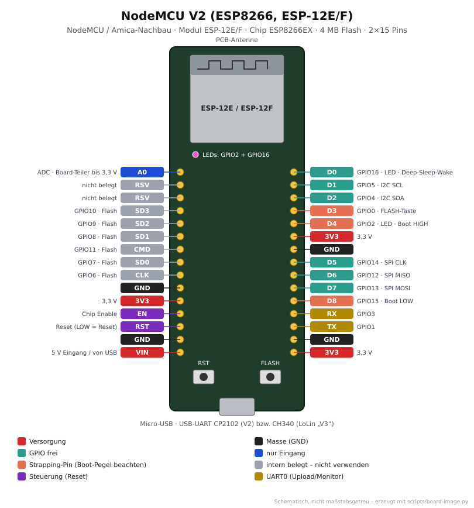
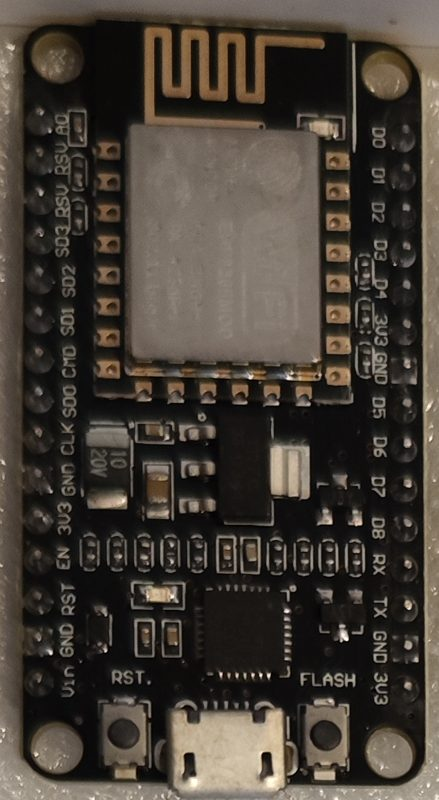

# NodeMCU V2 (ESP8266, ESP-12E/F)

<p align="center"></p>

<p align="center"><br><em>Eigenes Exemplar: NodeMCU V2 (Amica-Layout, Micro-USB, Tasten RST/FLASH)</em></p>

Das klassische ESP8266-Entwicklungsboard. Die schmale Version mit CP2102 heißt oft
„NodeMCU V2“ oder „Amica“. Die breitere LoLin-Version mit CH340 wird als „V3“ verkauft
und hat dieselbe Pinbelegung. Gut für einfache WLAN-Sensoren und kleine WLED-Installationen.
**Kein ESP32:** anderer Arduino-Core, kein Bluetooth, nur ein Analogeingang.

## Von der Familie zum Board

| Ebene       | Bezeichnung                 | Erklärung |
|-------------|-----------------------------|-----------|
| Hersteller  | Espressif Systems (Chip), Ai-Thinker (Modul), NodeMCU/Amica/LoLin (Board) | |
| Familie     | **ESP8266**                 | Tensilica L106, 1 Kern, 80/160 MHz, nur WLAN |
| Chip        | **ESP8266EX**               | kein Flash im Chip |
| Modul       | **ESP-12E** oder **ESP-12F**| Chip + 4 MB Flash + PCB-Antenne; 12F hat eine verbesserte Antenne |
| Board       | **NodeMCU V2** (Dev Kit 1.0)| Modul + CP2102 + 3,3-V-Regler + RST/FLASH + 2×15 Pins |
| PlatformIO  | `nodemcuv2` → Basis `esp8266_base` | siehe [`boards/boards.ini`](../../boards/boards.ini) |

## Technische Daten

| Eigenschaft | Wert |
|-------------|------|
| CPU         | 1× Tensilica L106, 80 MHz (160 MHz möglich) |
| Speicher    | ca. 80 KB RAM für Anwendungen, 4 MB Flash |
| Funk        | WLAN 802.11 b/g/n 2,4 GHz, **kein Bluetooth** |
| GPIOs       | 11 nutzbar (D0–D8, RX, TX), 1 ADC (A0) |
| USB         | Micro-USB, CP2102 (V2) bzw. CH340 (V3) |
| Versorgung  | 5 V über USB oder VIN |
| Logikpegel  | 3,3 V (**nicht 5-V-tolerant**) |

## Pinbelegung

**Frei nutzbar (empfohlen):** D1 (GPIO5), D2 (GPIO4), D5 (GPIO14), D6 (GPIO12), D7 (GPIO13)

| Pin | GPIO | Einschränkung |
|-----|------|---------------|
| D0  | 16   | kein PWM, kein I2C, kein Interrupt; mit RST verbinden für Wake-up aus Deep Sleep; Board-LED (active LOW) |
| D3  | 0    | FLASH-Taste – muss beim Start HIGH sein |
| D4  | 2    | LED des Moduls (active LOW) – muss beim Start HIGH sein |
| D8  | 15   | muss beim Start LOW sein (Pull-down auf der Platine) |
| RX/TX | 3/1 | UART0 – Upload und serieller Monitor |
| SD2/SD3 | 9/10 | gehören zum Flash – nicht verwenden |
| A0  | ADC  | 10 Bit; der Spannungsteiler auf dem Board erlaubt 0–3,3 V (am Chip 0–1 V) |

**Standard-Schnittstellen (Arduino):** I2C SDA D2 (GPIO4) / SCL D1 (GPIO5) ·
SPI SCK D5, MISO D6, MOSI D7, CS D8. Im Code gehen `D1`, `D2` … oder die GPIO-Nummern.

## Verwendung im Repo

```bash
cd projects/blink
pio run -e nodemcuv2 -t upload -t monitor
```

| Zweck     | Einstellung |
|-----------|-------------|
| Projekte  | `[env:nodemcuv2]` mit `extends = esp8266_base` (in allen allgemeinen Projekten) |
| OLED-Test | [`projects/oled-demo`](../../projects/oled-demo) mit externem SSD1306 128×64 an D2/D1 |
| WLED      | Env `wled_nodemcuv2` in [`wled/platformio_override.ini`](../../wled/platformio_override.ini) |
| WLAN im Code | `#include <ESP8266WiFi.h>` statt `<WiFi.h>` (siehe [Eigene Projekte](../04-eigene-projekte.md)) |

## Typische Probleme

| Problem | Ursache / Lösung |
|---------|------------------|
| Bootet nicht mit angeschlossener Last | D3, D4 oder D8 beim Start falsch gezogen – andere Pins nehmen |
| Wirre Zeichen beim Start | Boot-ROM sendet mit 74880 Baud – normal |
| `ledcWrite`, `BluetoothSerial`, `WiFi.h` fehlen | ESP32-Code – auf ESP8266-APIs umstellen (`analogWrite`, `ESP8266WiFi.h`) |
| Reset-Schleife bei WLAN-Start | Netzteil/USB-Port zu schwach oder Watchdog: in langen Schleifen `yield()` aufrufen |

## Quellen

- Espressif: [ESP8266EX Datenblatt](https://www.espressif.com/sites/default/files/documentation/0a-esp8266ex_datasheet_en.pdf)
- NodeMCU: [Dev Kit 1.0 Schaltplan](https://github.com/nodemcu/nodemcu-devkit-v1.0)
- Random Nerd Tutorials: [ESP8266 Pinout Reference](https://randomnerdtutorials.com/esp8266-pinout-reference-gpios/)
- PlatformIO: [NodeMCU 1.0 (ESP-12E Module)](https://docs.platformio.org/en/latest/boards/espressif8266/nodemcuv2.html)
