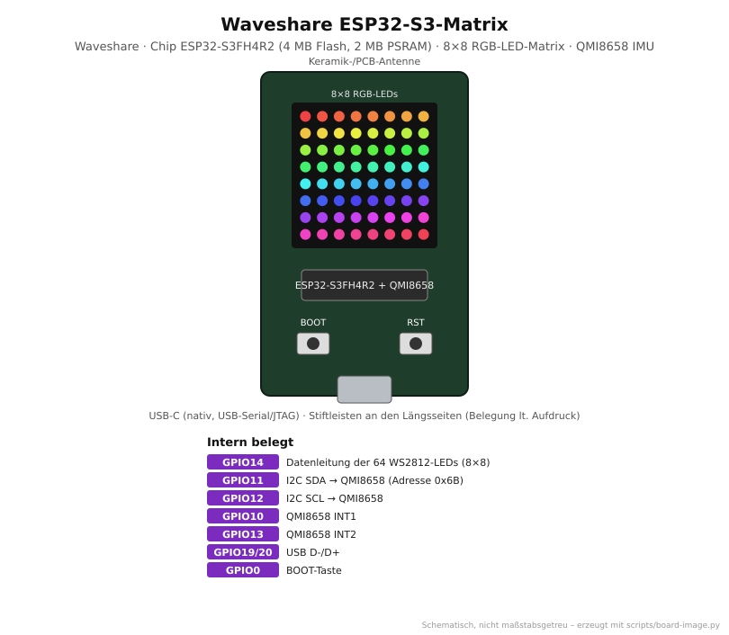

# Waveshare ESP32-S3-Matrix

<p align="center"></p>

Sehr kleines ESP32-S3-Board mit einer **8×8 RGB-LED-Matrix** (64 adressierbare LEDs)
auf der Vorderseite und einem **QMI8658-Lage- und Beschleunigungssensor** (6 Achsen).
Ideal für Anzeigen, Lagespiele, Statusanzeigen oder als Mini-WLED-Matrix.

## Von der Familie zum Board

| Ebene       | Bezeichnung                         | Erklärung                                                            |
|-------------|-------------------------------------|----------------------------------------------------------------------|
| Hersteller  | Espressif Systems (Chip), Waveshare (Board) |                                                              |
| Familie     | **ESP32-S3**                        | Xtensa LX7, 2 Kerne, natives USB, WLAN + BLE 5                       |
| Chip        | **ESP32-S3FH4R2**                   | **F** Flash im Chip · **H** hochtemperaturfest · **4** MB Flash · **R2** 2 MB PSRAM (Quad-SPI) |
| Modul       | – (keins)                           | Der Chip sitzt direkt auf der Platine, Antenne auf dem Board          |
| Board       | **Waveshare ESP32-S3-Matrix**       | Chip + 8×8 WS2812-Matrix + QMI8658 + USB-C + Stiftleisten             |
| PlatformIO  | `lolin_s3_mini` → Basis `waveshare_s3_matrix_base` | gleicher Chip wie das LOLIN S3 Mini, siehe [`boards/boards.ini`](../../boards/boards.ini) |

Ein eigenes PlatformIO-Board-Profil für die Matrix gibt es nicht. `lolin_s3_mini` passt,
weil beide Boards den ESP32-S3FH4R2 (4 MB Flash, 2 MB PSRAM) verwenden.

## Technische Daten

| Eigenschaft        | Wert                                                                  |
|--------------------|-----------------------------------------------------------------------|
| CPU                | 2× Xtensa LX7, bis 240 MHz                                            |
| Speicher           | 512 KB SRAM, 2 MB PSRAM (Quad), 4 MB Flash – alles im Chip            |
| Funk               | WLAN 802.11 b/g/n 2,4 GHz, Bluetooth 5 (LE)                           |
| LED-Matrix         | 8×8 = 64 RGB-LEDs (WS2812-kompatibel), eine Datenleitung an **GPIO14** |
| Lagesensor         | QMI8658 (3-Achsen-Beschleunigung + 3-Achsen-Gyroskop), I2C-Adresse `0x6B` |
| USB                | USB-C, nativ am ESP32-S3 (USB-Serial/JTAG) – kein separater USB-UART-Wandler |
| Taster             | BOOT (GPIO0), RESET                                                   |
| Erweiterung        | Stiftleisten mit weiteren GPIOs und Versorgung (Belegung laut Aufdruck auf der Platine / Waveshare-Wiki) |

## Intern belegte Pins

| GPIO   | Funktion                          | Hinweis                                             |
|--------|-----------------------------------|-----------------------------------------------------|
| 14     | Daten der 8×8-LED-Matrix          | nicht für andere Zwecke verwenden                   |
| 11     | I2C SDA zum QMI8658               | weitere I2C-Geräte können mitbenutzt werden         |
| 12     | I2C SCL zum QMI8658               |                                                     |
| 10     | QMI8658 Interrupt 1               | laut ESPHome-Community weniger zuverlässig als INT2 |
| 13     | QMI8658 Interrupt 2               |                                                     |
| 19, 20 | USB D-/D+                         | für Upload und seriellen Monitor                    |
| 0      | BOOT-Taste                        | als Benutzertaste nutzbar (siehe `matrix-demo`)     |

Die übrigen GPIOs liegen an den Stiftleisten. Für eigene Beschaltung die Beschriftung
auf der Platine bzw. das Pinout-Bild im Waveshare-Wiki verwenden.

## ⚠️ Helligkeit und Wärme

64 LEDs auf sehr kleiner Fläche erzeugen viel Wärme. Bei voller Helligkeit in Weiß
ziehen sie rechnerisch über 3 A, deutlich mehr, als USB und Board vertragen.

- Helligkeit im Dauerbetrieb **niedrig** halten (≈ 20–40 von 255).
- In WLED ein Stromlimit setzen. Im Repo ist `ABL_MILLIAMPS_DEFAULT=500` voreingestellt.
- Nicht längere Zeit vollflächig weiß leuchten lassen.

## LED-Reihenfolge und Farbreihenfolge

Wie die 64 LEDs verkettet sind (zeilenweise oder im Zickzack) und ob die Farben
in RGB- oder GRB-Reihenfolge erwartet werden, ist in den Quellen nicht einheitlich
beschrieben. Das Repo nimmt **zeilenweise** und **RGB** an. Mit dem Projekt
[`matrix-demo`](../../projects/matrix-demo) lässt sich beides in einer Minute prüfen:

1. Beim Start leuchtet die Matrix nacheinander **Rot → Grün → Blau**. Stimmt eine
   Farbe nicht, in `boards/boards.ini` `MATRIX_COLOR_ORDER` auf `NEO_GRB` ändern.
   In WLED entsprechend die Farbreihenfolge unter **LED Preferences** umstellen.
2. Modus 0 lässt ein Pixel von LED 0 bis 63 wandern. Der Monitor zeigt den Index an.
   Daran erkennt man, wo LED 0 liegt und in welche Richtung die Kette läuft.

## Verwendung im Repo

```bash
cd projects/matrix-demo
pio run -e waveshare_s3_matrix -t upload -t monitor
```

| Zweck            | Einstellung                                                                      |
|------------------|----------------------------------------------------------------------------------|
| Projekte         | `[env:waveshare_s3_matrix]` mit `extends = waveshare_s3_matrix_base` – in [`matrix-demo`](../../projects/matrix-demo) und [`wlan-matrix`](../../projects/wlan-matrix) (WLAN-Ausleuchtung) |
| Defines          | `MATRIX_PIN=14`, `MATRIX_WIDTH=8`, `MATRIX_HEIGHT=8`, `IMU_SDA_PIN=11`, `IMU_SCL_PIN=12`, `MATRIX_COLOR_ORDER` |
| Flash-Modus      | `dio` (wie in der ESPHome-Gerätedatenbank)                                        |
| Partitionen      | `default.csv` (2× 1,25 MB App für OTA)                                           |
| WLED             | Env `wled_s3_matrix` in [`wled/platformio_override.ini`](../../wled/platformio_override.ini) |
| WLED-Release     | `WLED_x.y.z_ESP32-S3_4M_qspi.bin`, danach LED-Pin 14 und 64 LEDs einstellen      |

### WLED als 8×8-Matrix einrichten

1. Firmware per Web-Installer, Release-Datei (`ESP32-S3_4M_qspi`) oder `./scripts/wled-build.sh wled_s3_matrix` aufspielen.
2. **Config → LED Preferences:** GPIO **14**, Länge **64**, Stromlimit ≤ 500 mA.
3. **Config → 2D Configuration:** Strip or panel = *2D Matrix*, 1 Panel, **8 × 8**.
   Anordnung (erste LED, Serpentine ja/nein) entsprechend dem Pixel-Test einstellen.
4. Jetzt stehen die 2D-Effekte (Matrix, Game of Life, Scrolling Text …) zur Verfügung.

### Lagesensor auslesen

Der QMI8658 lässt sich in Arduino z. B. mit der Bibliothek **SensorLib** (Lewis He) auslesen:

```ini
lib_deps = lewisxhe/SensorLib
```

```cpp
#include <Wire.h>
#include "SensorQMI8658.hpp"

SensorQMI8658 imu;

void setup() {
  imu.begin(Wire, 0x6B, IMU_SDA_PIN, IMU_SCL_PIN);
}
```

Die genaue API hängt von der SensorLib-Version ab. Siehe deren Beispiel `QMI8658_GetDataExample`.

## Quellen

- Waveshare: [Produktseite](https://www.waveshare.com/esp32-s3-matrix.htm) · [Wiki mit Schaltplan und Pinout](https://www.waveshare.com/wiki/ESP32-S3-Matrix)
- ESPHome-Gerätedatenbank: [Waveshare ESP32-S3 Matrix](https://devices.esphome.io/devices/waveshare-esp32s3-matrix/) (Pinbelegung GPIO10–14)
- Espressif: [ESP32-S3 Datenblatt](https://www.espressif.com/sites/default/files/documentation/esp32-s3_datasheet_en.pdf)
