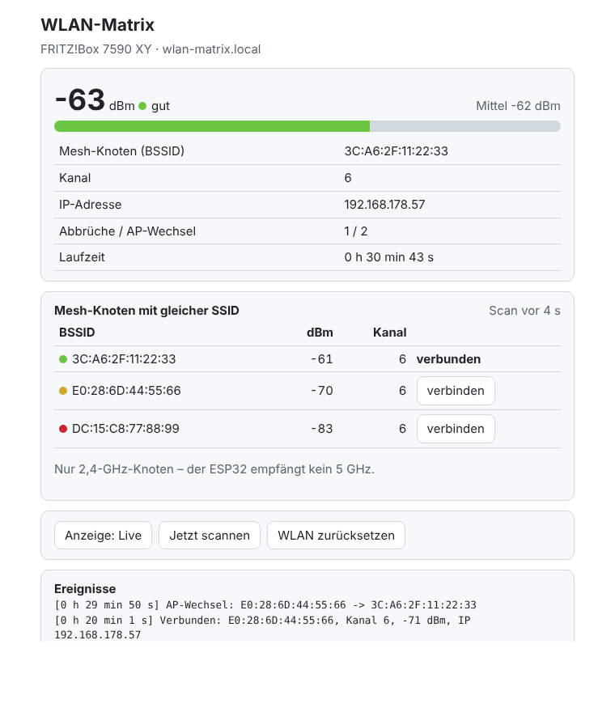

# wlan-matrix

Misst die WLAN-Feldstärke in einem Gebäude und stellt sie auf einer RGB-LED-Matrix
farbig dar, zusätzlich in einer Weboberfläche. Gedacht für die Ausleuchtungsprüfung
in Mesh-Netzen, z. B. FRITZ!Box mit Repeatern bzw. Access Points, die alle dieselbe
SSID senden.



## Funktionen

- **Konfigurations-Hotspot:** Beim ersten Start öffnet der ESP32 einen eigenen Access
  Point. Über ein Portal werden SSID und Passwort eingetragen und dauerhaft im Flash
  gespeichert. Für ein anderes Netz muss nicht neu geflasht werden.
- **Live-Modus:** Balkenanzeige der Signalstärke, farbcodiert und geglättet, damit sie
  nicht flackert. Ein weißer Punkt in der obersten Reihe kennzeichnet den Mesh-Knoten,
  mit dem der ESP32 verbunden ist. Springt der Punkt, hat ein AP-Wechsel stattgefunden.
- **Mesh-Modus:** eine Zeile je Mesh-Knoten mit gleicher SSID, nach Stärke sortiert.
  Der verbundene Knoten blinkt. So sieht man an jedem Standort, welcher Access Point
  eigentlich der beste wäre.
- **Saubere WLAN-Erkennung:**
  - Verbindungsabbrüche werden mit Ursache erkannt, z. B. „Beacon-Timeout“ oder „Handshake Timeout“.
  - AP-Wechsel (Roaming) werden erkannt und gezählt.
  - Nach einem Abbruch verbindet sich der ESP32 automatisch neu. Klappt das nicht, stößt er alle 30 s selbst einen Versuch an und startet nach 5 min offline neu.
  - Alle Vorgänge landen in einem Ereignisprotokoll.
- **Weboberfläche** unter `http://wlan-matrix.local/`:
  - aktuelle und gemittelte Signalstärke, BSSID, Kanal und IP
  - Zähler für Abbrüche und AP-Wechsel
  - Liste aller Mesh-Knoten und das Ereignisprotokoll
  - Schaltflächen für den Modus, einen sofortigen Scan und das Zurücksetzen der WLAN-Daten
  - **gezielt mit einem Knoten verbinden**, um zu testen, ob ein anderer Access Point besser wäre
- **Serielles Protokoll:** alle 10 s eine Tabelle mit BSSID, dBm und Kanal, brauchbar
  zum Mitschreiben beim Rundgang durchs Gebäude.

### Farbcode

| Farbe    | RSSI       | Bewertung                |
|----------|------------|--------------------------|
| grün     | ≥ −55 dBm  | sehr gut                 |
| hellgrün | ≥ −65 dBm  | gut                      |
| gelb     | ≥ −72 dBm  | brauchbar                |
| orange   | ≥ −80 dBm  | schwach                  |
| rot      | < −80 dBm  | kritisch, Abbruchgefahr  |

### Anzeige auf der Matrix

| Anzeige              | Bedeutung                                   |
|----------------------|---------------------------------------------|
| blaues Lauflicht     | Start                                       |
| gelb                 | verbindet mit dem WLAN                      |
| blau (ganze Fläche)  | Konfigurations-Hotspot ist offen            |
| grün (kurz)          | verbunden                                   |
| rotes X              | Verbindung verloren, Wiederverbindung läuft |

## Hardware

| Variante                    | Env                    | Matrix                                         |
|-----------------------------|------------------------|------------------------------------------------|
| ESP32 DevKit (WROOM-32)     | `esp32dev`             | externe WS2812B 8×8 an **GPIO13**, Zickzack     |
| ESP32-S3-DevKitC-1          | `esp32s3`              | externe WS2812B 8×8 an **GPIO13**, Zickzack     |
| [Waveshare ESP32-S3-Matrix](../../docs/boards/waveshare-esp32-s3-matrix.md) | `waveshare_s3_matrix` | eingebaut, GPIO14, Helligkeit und Strom reduziert |

Für eine externe Matrix:

- 5-V-Netzteil mit mindestens 2 A, die Matrix **nicht** über den USB-Port des ESP32 speisen.
- 330-Ω-Widerstand in der Datenleitung, 1000-µF-Kondensator über 5 V / GND.

| Matrix | ESP32                                          |
|--------|------------------------------------------------|
| DIN    | GPIO13 (über 330 Ω)                            |
| 5V     | externes Netzteil                              |
| GND    | Netzteil **und** ESP32-GND (gemeinsame Masse)  |

Eine MAX7219-Matrix ist ungeeignet, sie kann nur einfarbig.

## Benutzung

```bash
cd projects/wlan-matrix
pio run -e esp32dev -t upload -t monitor              # oder -e waveshare_s3_matrix
```

1. Mit dem Hotspot **`ESP32-WLAN-Matrix`** verbinden (Passwort `12345678`). Das Portal
   öffnet sich, sonst <http://192.168.4.1> aufrufen.
2. Heim-WLAN auswählen, Passwort eingeben, speichern.
3. Weboberfläche öffnen: `http://wlan-matrix.local/` bzw. die IP aus dem seriellen Monitor.

| Taster (GPIO0 / BOOT) | Wirkung                                    |
|-----------------------|--------------------------------------------|
| kurz (< 1 s)          | Umschalten Live-Modus ↔ Mesh-Modus         |
| lang (> 3 s)          | Zugangsdaten löschen, Portal neu öffnen    |

## Einstellungen

Alle Einstellungen sind Defines am Anfang von `src/main.cpp` und lassen sich pro Env
über `build_flags` in `platformio.ini` überschreiben:

| Define            | Standard              | Bedeutung                                   |
|-------------------|-----------------------|---------------------------------------------|
| `LED_PIN`         | 13 (Waveshare: 14)    | Datenpin der Matrix                         |
| `MATRIX_W` / `MATRIX_H` | 8 / 8           | Größe, z. B. 16×16, Balken skalieren mit    |
| `SERPENTINE`      | `true`                | Zickzack-Verdrahtung                        |
| `LED_COLOR_ORDER` | `GRB`                 | bei falschen Farben `RGB` oder `BRG` testen |
| `BRIGHTNESS`      | 40                    | Helligkeit 0–255                            |
| `MAX_MILLIAMPS`   | 1500                  | Strombegrenzung                             |
| `AP_NAME` / `AP_PASS` | `ESP32-WLAN-Matrix` / `12345678` | Konfigurations-Hotspot, **Passwort ändern** |
| `HOSTNAME`        | `wlan-matrix`         | mDNS-Name der Weboberfläche                 |
| `SCAN_INTERVAL`   | 10000                 | ms zwischen zwei Scans                      |

Beispiel: `build_flags = ${esp32_base.build_flags} -D LED_PIN=13 -D AP_PASS='"geheim123"'`

## Web-API

| Methode | Pfad              | Wirkung                                                      |
|---------|-------------------|--------------------------------------------------------------|
| GET     | `/`               | Weboberfläche                                                |
| GET     | `/api/status`     | JSON: Verbindung, RSSI, Knoten, Ereignisse                   |
| POST    | `/api/mode`       | Live ↔ Mesh umschalten                                       |
| POST    | `/api/rescan`     | sofort scannen                                               |
| POST    | `/api/connect`    | Body = Index aus `nodes`: gezielt mit diesem Knoten verbinden |
| POST    | `/api/reset-wifi` | Zugangsdaten löschen und Portal öffnen                       |

```bash
curl http://wlan-matrix.local/api/status
curl -X POST -d 1 http://wlan-matrix.local/api/connect   # zweitstärksten Knoten testen
```

Die API hat keine Anmeldung. Das Gerät deshalb nur im eigenen Netz betreiben.

Eine gezielte Verbindung zu einem Knoten wird nicht dauerhaft gespeichert. Nach einem
Neustart verbindet sich der ESP32 wieder mit dem Knoten, den der Router vorgibt.

## Wenn es klemmt

| Symptom                                   | Ursache / Abhilfe                                            |
|-------------------------------------------|--------------------------------------------------------------|
| kein Port in `pio device list`            | USB-Treiber fehlt: CP2102 → Silicon Labs VCP, CH340 → WCH     |
| Port fehlt trotz Treiber                  | reines Ladekabel ohne Datenadern, anderes Kabel nehmen       |
| `Connecting…....` läuft ins Timeout       | BOOT-Taster gedrückt halten, bis der Upload startet          |
| `could not open port … access denied`     | serieller Monitor blockiert den Port, mit Strg+C schließen   |
| Upload bricht ab                          | `upload_speed = 460800` oder `115200` setzen                 |
| Farben falsch                             | `LED_COLOR_ORDER` ändern                                     |
| Balken gespiegelt / zickzackförmig        | `SERPENTINE` umschalten oder Matrix um 180° drehen           |
| `wlan-matrix.local` nicht erreichbar      | IP aus dem seriellen Monitor oder der FRITZ!Box verwenden    |
| Mesh-Modus zeigt nur einen Knoten         | Repeater funken evtl. nur auf 5 GHz, siehe unten             |

Weitere allgemeine Hilfe: [Fehlerbehebung](../../docs/05-fehlerbehebung.md).

Für mehrere Messstellen, Dauermessung und einen Bericht mit Lageplan gibt es das
[WLAN-Analyse-Modul](../../docs/06-wlan-analyse.md) ([`wlan-sonde`](../wlan-sonde) + `tools/wlan-analyse`).

## Einordnung der Messwerte

- Die Antenne eines ESP32-DevKits empfängt schlechter als ein Smartphone. Die Werte
  taugen für Vergleiche **innerhalb** des Gebäudes, nicht als Absolutmaß gegenüber
  Herstellerangaben.
- Der ESP32 funkt nur im **2,4-GHz-Band**. 5-GHz-Knoten und die 5-GHz-Backbone-Verbindung
  zwischen FRITZ!Box und Repeatern sieht er nicht.
- Angezeigt wird nur die Empfangsrichtung. Ein Access Point kann gut ankommen, während
  der Rückkanal schwächelt. Für belastbare Aussagen zum Durchsatz zusätzlich Ping- oder
  iperf-Messungen fahren.
- Während eines Scans (alle 10 s, ca. 2–4 s lang) wechselt der ESP32 kurz die Kanäle.
  Antworten können dann einige hundert Millisekunden verzögert sein. Das ist normal
  und kein Abbruch.
