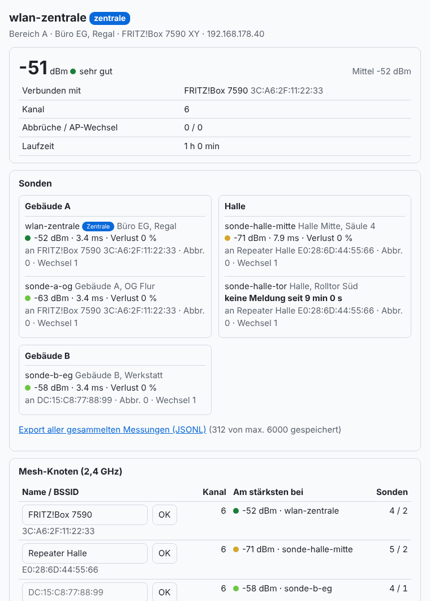
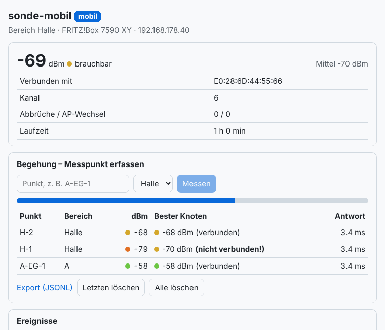

# wlan-sonde

Messgerät des **WLAN-Analyse-Moduls**. Konzept, Messplan und Auswertung stehen in
[docs/06-wlan-analyse.md](../../docs/06-wlan-analyse.md).

Eine Firmware für alle Geräte, drei Rollen:

| Rolle | Aufgabe | Anzeige (falls LED-Matrix) |
|---|---|---|
| **sonde** | fest montiert, misst alle *N* Sekunden, meldet an die Zentrale, sendet nach Ausfällen nach | eigene Signalstärke |
| **mobil** | Begehung: Messpunkt per Webseite oder BOOT-Taste, Speicherung im Flash | Fortschritt, danach Signalstärke |
| **zentrale** | sammelt alle Sonden, misst selbst mit, Übersicht im Browser | Gebäude-Übersicht A \| Halle \| B |

Gemessen wird je Messung:

- Signalstärke des verbundenen Mesh-Knotens: Mittel, Minimum und Maximum seit der letzten Messung
- alle Knoten mit **gleicher SSID** (Repeater/Access Points) mit Signalstärke und Kanal
- **fremde Netze** je Kanal (Anzahl und stärkstes Netz)
- **Antwortzeit** des Routers (5 TCP-Verbindungsaufbauten zu Port 80) und Verlust
- Verbindungsabbrüche mit Ursache und AP-Wechsel (Roaming)

## Umgebungen

| Env | Board | Hinweis |
|---|---|---|
| `esp32dev` | ESP32-DevKitC | Standard-Sonde ohne Anzeige |
| `esp32dev_matrix` | ESP32-DevKitC + WS2812B 8×8 an GPIO13 | Sonde/Mobil mit Anzeige |
| `esp32c3` | ESP32-C3 (Super Mini) | kleine Sonde, BOOT = GPIO9 |
| `esp32s3` | ESP32-S3-DevKitC-1 | ohne Anzeige |
| `waveshare_s3_matrix` | [Waveshare ESP32-S3-Matrix](../../docs/boards/waveshare-esp32-s3-matrix.md) | **voreingestellt als Zentrale**, Puffer im PSRAM (6000 Messungen) |

```bash
cd projects/wlan-sonde
pio run -e waveshare_s3_matrix -t upload -t monitor
pio run -e esp32dev -t upload -t monitor
```

## Einrichtung

1. Beim ersten Start öffnet das Gerät den Hotspot `WLAN-Sonde-XXXX` (Passwort `12345678`).
2. Im Portal das WLAN wählen und die Felder ausfüllen: **Gerätename, Rolle, Bereich (A/Halle/B), Ort, Zentrale, Intervall**.
3. Danach ist das Gerät unter `http://<gerätename>.local/` erreichbar. Alle Einstellungen lassen sich dort ändern.

Die Sonden finden die Zentrale über `http://wlan-zentrale.local` (mDNS). Klappt das im Netz nicht,
die IP-Adresse eintragen. Statt einer ESP32-Zentrale kann auch ein PC sammeln:
`python3 -m wlan_analyse sammeln` (siehe [tools/wlan-analyse](../../tools/wlan-analyse)).

| Taster (BOOT) | Sonde | Mobil | Zentrale |
|---|---|---|---|
| kurz | sofort messen | Messpunkt `P<n>` aufnehmen | Matrix: Übersicht ↔ eigene Signalstärke |
| lang (> 3 s) | WLAN-Daten löschen, Portal öffnen | ← | ← |

## Weboberfläche

<table><tr>
<td></td>
<td></td>
</tr><tr><td>Zentrale: Sonden je Bereich, Mesh-Knoten benennen</td><td>Mobil: Messpunkte der Begehung</td></tr></table>

Mit Testdaten gerendert.

## Web-API

| Methode | Pfad | Rolle | Wirkung |
|---|---|---|---|
| GET | `/api/status` | alle | Verbindung, letzte Messung, Puffer, Sender, Ereignisse |
| GET | `/api/export` | alle | alle gespeicherten Messungen als JSON Lines |
| POST | `/api/messen` | sonde, zentrale | sofort messen |
| POST | `/api/punkt` | mobil | Messpunkt starten, Body `{"punkt":"H-3","bereich":"Halle"}` |
| GET | `/api/punkte` | mobil | alle Messpunkte als JSON-Liste |
| POST | `/api/punkt/loeschen` | mobil | Body `letzter` oder `alle` |
| POST | `/api/sonde` | zentrale | Messung einer Sonde entgegennehmen (Format siehe Anleitung) |
| GET | `/api/sonden` | zentrale | alle Sonden mit letzter Messung |
| GET/POST | `/api/knoten` | zentrale | gesehene Mesh-Knoten; Name vergeben mit `{"bssid":…,"name":…}` |
| POST | `/api/config` | alle | Einstellungen (Formular), danach Neustart |
| POST | `/api/reset-wifi` | alle | WLAN-Daten löschen |

Die API hat keine Anmeldung. Die Geräte deshalb nur im eigenen Netz betreiben.

## Speicher

| Rolle | Puffer | Verhalten |
|---|---|---|
| sonde | 240 Messungen im RAM | 2 h bei 30 s. Was offline gemessen wurde, wird nachgesendet, solange es im Puffer liegt. |
| zentrale | 400 (ohne PSRAM) / 6000 (mit PSRAM) | Älteste werden überschrieben. Für lange Messreihen regelmäßig `abrufen` oder den PC-Sammler nutzen. |
| mobil | Flash (LittleFS) | Messpunkte bleiben über Neustarts erhalten, bis sie gelöscht werden. |

## Einstellungen beim Bauen

In `src/config.h`, per `build_flags` überschreibbar: `DEFAULT_ROLLE`, `DEFAULT_INTERVALL`, `AP_PASS`,
`NTP_SERVER` (Standard `fritz.box`), `ROUTER_PORT`, Puffergrößen, Matrix-Pins und Helligkeit.
